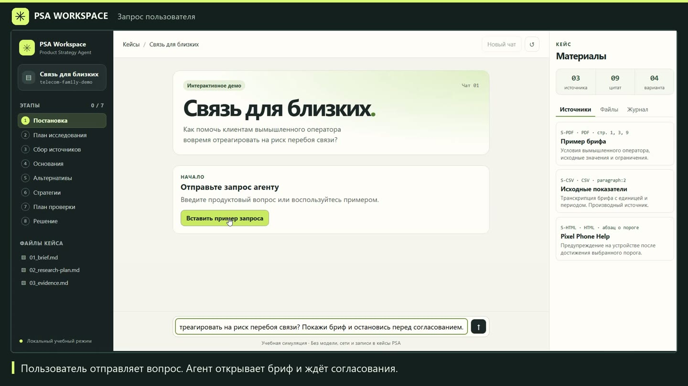
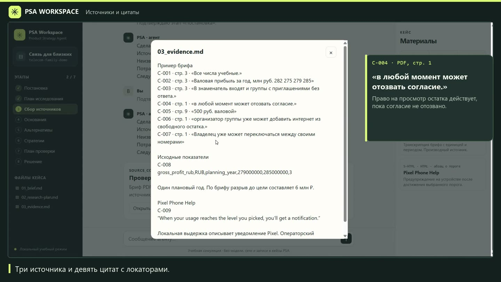
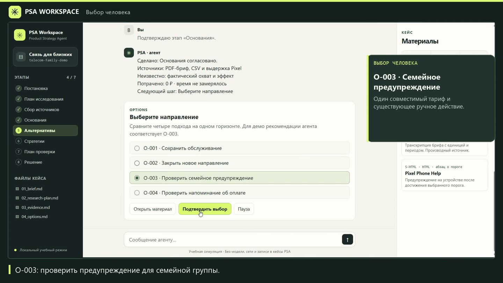
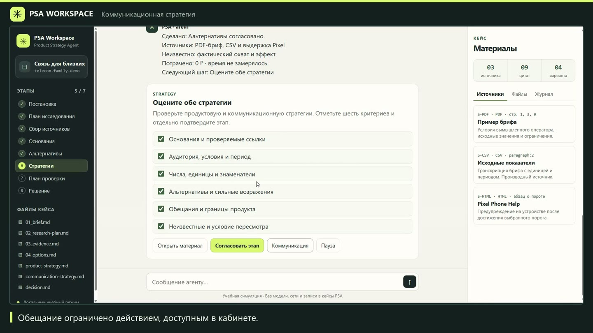
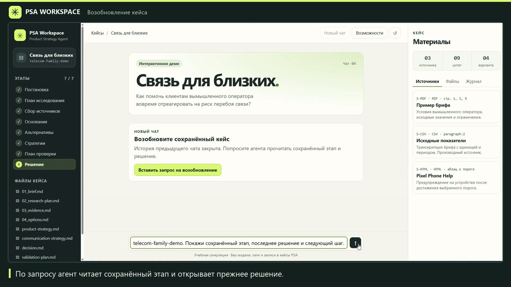
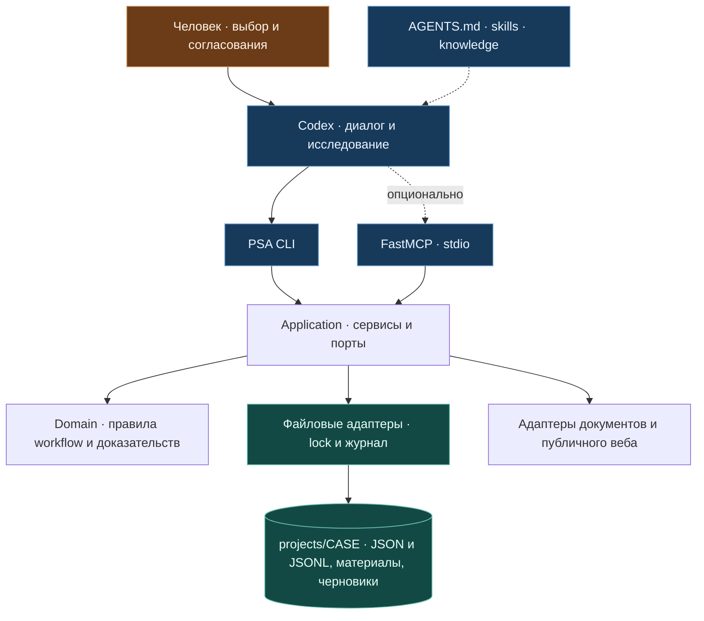
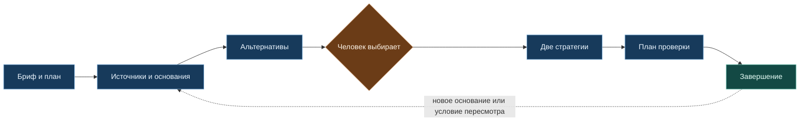
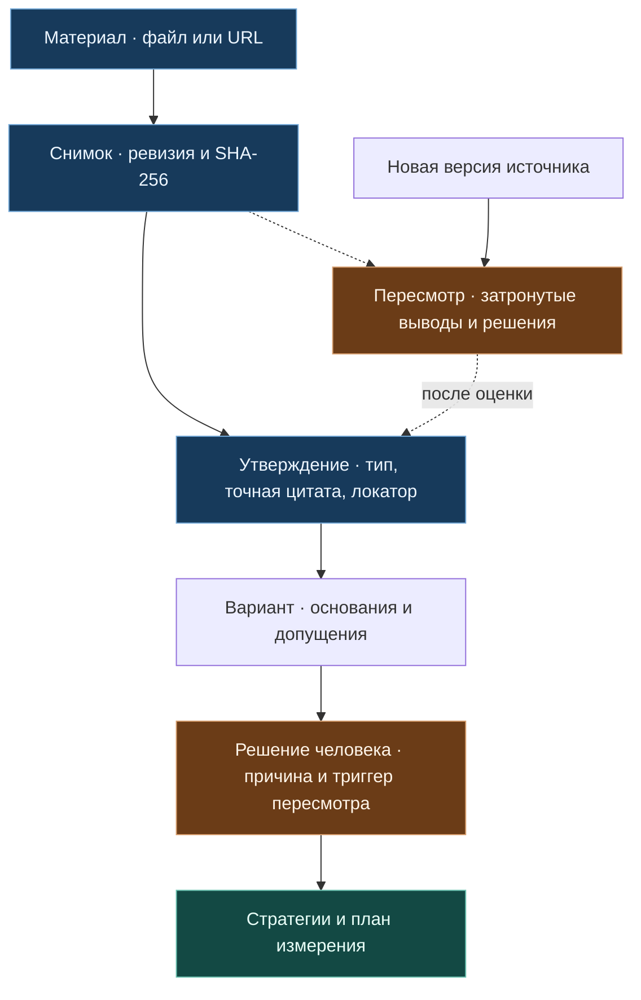
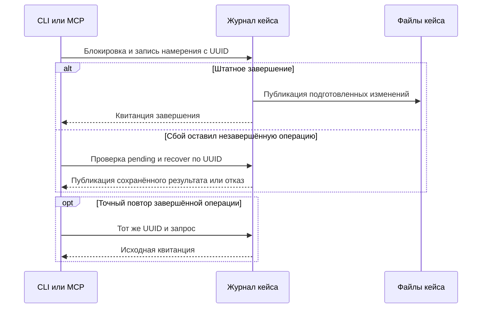

# Product Strategy Agent

Проект команды **bogomol** для хакатона **MGIMO AI CHALLENGE**.

[](pyproject.toml)
[](pyproject.toml)
[](pyproject.toml)
[](docs/codex-demo-guide.md)
[](docs/mcp.md)
[](#быстрый-запуск)

**Агент в Codex для руководителя цифрового продукта.** Из продуктового вопроса и исходных материалов PSA собирает доказательства и сравнивает варианты. Руководитель выбирает направление, затем агент готовит две стратегии и план проверки эффекта. Кейс сохраняется на диске, и работу можно продолжить в новом чате.

[▶ Смотреть демо · 4:38](docs/demo-ui/psa-workspace-demo.mp4) · [🚀 Подключить агента](USAGE.md) · [📘 Открыть PDF](docs/project-description.pdf) · [📋 Сверить с ТЗ](reports/2026-11-22-final-specs-audit.md)



*PSA Workspace воспроизводит подготовленный телеком-сценарий в браузере. Для живой работы с агентом откройте репозиторий в Codex.*

| Попробовать | Изучить | Проверить |
| --- | --- | --- |
| [Браузерная репетиция](docs/demo-ui/README.md) | [Архитектура и схемы](#архитектура) | [Подтверждённые результаты](#проверенные-результаты) |
| [Подключение и работа в Codex](USAGE.md) | [Описание проекта в Markdown](docs/project-description.md) | [Демонстрационный проект для сдачи](docs/demo-project/) |

## Быстрый запуск

Подробное подключение, первый запрос, согласования и восстановление работы описаны в [инструкции пользователя](USAGE.md).

Откройте корень репозитория как локальный проект в Codex и начните новый чат. Проектные правила находятся в [AGENTS.md](AGENTS.md). Для CLI нужны **Python 3.11+** и **uv 0.11.30**. Основной сценарий использует файловое хранилище и учётную запись Codex. Отдельный API-ключ, `.env`, база данных и контейнеры для него не требуются.

В PowerShell из корня репозитория:

```powershell
uv sync --locked --no-default-groups
uv run --no-sync psa doctor
uv run --no-sync python -m scripts.ci.demo
```

> [!TIP]
> Последняя команда воспроизводит два учебных кейса на временных копиях, проверяет цитаты и покрытие, возобновляет кейсы и пересобирает отчёты. После установки зависимостей этот прогон работает офлайн и обходится без вызовов модели. Предупреждение о FastMCP ожидаемо при базовой установке.

## Телеком-демо

[Демонстрационный проект «Связь для близких»](docs/demo-project/) содержит бриф и исходники, карту доказательств, обе стратегии, план измерения, воспроизводимый прогноз и историю пересмотра решения.

В [учебном брифе](<specs/Пример брифа.pdf>) вымышленный оператор решает, какую помощь со связью исследовать первой. Агент сопоставляет бриф, производную CSV-таблицу и выдержку из открытой справки Pixel, затем сравнивает четыре направления.

### Скриншоты демо

| Источники и доказательства | Выбор руководителя |
| --- | --- |
| [](docs/project-description-assets/evidence.jpg) | [](docs/demo-ui/media/readme-options.jpg) |
| В реестре видны цитаты и привязки к исходным материалам. | Вариант O-003 выбран после сравнения четырёх направлений. |

| Проверка стратегии | Продолжение после паузы |
| --- | --- |
| [](docs/demo-ui/media/readme-strategy-review.jpg) | [](docs/demo-ui/media/readme-resume.jpg) |
| Руководитель проверяет стратегии перед переходом. | После запроса в новом чате видно сохранённое состояние и решение. |

[Смотреть сквозной сценарий · MP4](docs/demo-ui/psa-workspace-demo.mp4) · [Репетировать в браузере](docs/demo-ui/README.md) · [Пройти в Codex](docs/codex-demo-guide.md)

### Воспроизвести кейс в Codex

```powershell
uv sync --locked --no-default-groups --extra documents
uv run --no-sync python examples/telecom-family/build_case.py
uv run --no-sync psa status telecom-family-demo
uv run --no-sync psa validate telecom-family-demo
uv run --no-sync psa verify telecom-family-demo
uv run --no-sync psa coverage telecom-family-demo
uv run --no-sync python projects/telecom-family-demo/analysis/forecast.py
```

Сборщик оставляет кейс на `intake` с тремя источниками, девятью цитатами, четырьмя вариантами и пустым журналом решений. Черновики относятся к условному выбору O-003. При заданных допущениях прогноз рассчитывает 279,25 и 278,65 млн ₽ валовой прибыли в двух сценариях при цели 285 млн ₽. Для повторной репетиции создайте другую копию с `--projects-dir PATH` и используйте тот же путь в последующих командах. [Инструкция примера](examples/telecom-family/README.md).

Первый запрос в Codex:

```text
Открой telecom-family-demo. Покажи текущий этап, три источника с проверяемыми
цитатами и четыре варианта. Отдельно перечисли неизвестные и остановись перед выбором.
```

Готовые реплики для согласований и возобновления собраны в [гайде Codex](docs/codex-demo-guide.md). Пройти тот же процесс на другой продуктовой задаче можно на кейсе [«Слот»](examples/slot-workshop/README.md).

### Как проверить выводы демо

В кейсе сравниваются четыре варианта. Среди них O-003, семейное предупреждение о риске потери связи. Начните с [таблицы вариантов](examples/telecom-family/analysis/options-comparison.md), затем проверьте, что каждый источник действительно позволяет сказать.

| Материал | Что в нём видно | Как использовать |
| --- | --- | --- |
| 📄 [PDF-бриф](<specs/Пример брифа.pdf>), `page:3` | 279 млн ₽ валовой прибыли за плановый год при цели 285 млн ₽ | Зафиксировать учебную базу и разрыв в 6 млн ₽ |
| 📊 CSV, `paragraph:2` | Те же значения с периодом и единицей измерения | Воспроизвести расчёт. CSV переносит данные из PDF |
| 🌐 [Снимок справки Pixel](examples/telecom-family/README.md#как-проверить-три-источника) | Телефон умеет уведомлять при достижении выбранного порога расхода данных | Учесть действующую альтернативу. Эффект семейного сигнала остаётся гипотезой |

Затем откройте [стратегию из пяти частей](examples/telecom-family/analysis/strategy-five-parts.md) и сверьте её с [расчётом](examples/telecom-family/analysis/forecast.py) и [планом проверки](examples/telecom-family/drafts/validation-plan.md). Так можно проследить путь от исходных чисел до предложения о пилоте и увидеть, какие допущения ещё требуют проверки.

> [!IMPORTANT]
> В свежей копии кейса черновики показывают, как выглядел бы O-003. Выбор и согласования открыты. Подтверждайте каждый переход в чате после просмотра материалов.

## FastMCP

К CLI можно добавить локальный сервер FastMCP 4.x через stdio:

```powershell
uv sync --locked --no-default-groups --extra documents --extra mcp
```

Для Codex укажите интерпретатор среды проекта и команду `-m product_strategy_agent.mcp_server` в локальной `.codex/config.toml`. Начните с четырёх инструментов чтения: `psa_status`, `psa_validate`, `psa_verify` и `psa_coverage`. Пример конфигурации и проверочный запрос находятся в [гайде Codex](docs/codex-demo-guide.md#опционально-подключите-fastmcp). Подробности в [контракте MCP](docs/mcp.md) и [отчёте приёмки](docs/mcp-host-acceptance.md).

## Архитектура



`src/product_strategy_agent/` разделён по ответственности. Интерфейсы принимают команды и вызывают общие application-сервисы. Правила предметной области живут в `domain/`, файловое хранилище, разбор форматов и HTTP — в адаптерах. CLI и MCP используют одно ядро. Опциональный LiteLLM-клиент устанавливается через extra `agent` и используется только для явно запрошенных операций. История выхода из PostgreSQL, Alembic и Docker сохранена в [решении R2](docs/legacy-retirement.md).

[Техническое описание с диаграммами и скриншотами · PDF](docs/project-description.pdf) · [Markdown](docs/project-description.md) · [Диаграммы MVP](diagrams/mvp/README.md)

## Жизненный цикл кейса



| Этап | Результат | Что проверить перед переходом |
| --- | --- | --- |
| `intake` | Вопрос решения, владелец, сроки и ограничения | Бриф и критерии успеха |
| `research_plan` | Вопросы исследования и допустимые источники | Достаточность плана и свежесть выбранной версии |
| `source_collection` | Источники, сохранённые тексты, оценки и ревизии | Происхождение, ограничения, `source quality` |
| `evidence_review` | Утверждения, противоречия и пробелы | Цитаты в пределах локатора, `validate` и `verify` |
| `options` | Статус-кво, закрытие направления и изменение | Выгоды, затраты, риски, возражения и `option check` |
| `strategy` | Записанный человеческий выбор, продуктовая и коммуникационная стратегии | Полнота, основания, обещания и смысловая оценка |
| `validation` | Метрика, база или способ её получить, окно, ответственный, правило остановки | Структура, числовые основания и отдельная смысловая оценка |
| `completed` | Решение, обоснование и условие возвращения к нему | Итоговые проверки и читаемые артефакты |

Каждый переход требует явного согласования человека. Для новых кейсов `strategy` и `validation` требуют отдельной оценки актуальных материалов по шести критериям. Автоматические проверки показывают состояние и блокировки. Решение сохраняется с владельцем, обоснованием, альтернативами и условием пересмотра. [Правила workflow](agent/workflow.md) · [semantic review](docs/semantic-review.md) · [режимы глубины исследования](docs/modes.md).

## Доказательства и продолжение



- **Ссылки на материал.** Факт требует источник, локатор и цитату. Для PDF используется `page:N`, для XLSX — `cell:'Лист'!B2`, для обычного текста — `paragraph:N` или `line:N`. Факты, интерпретации, гипотезы, прогнозы и синтетика имеют разные типы. Хеш и проверка цитаты подтверждают связь с сохранённым текстом. Истинность утверждения и достаточность оснований оцениваются отдельно. [Импорт документов](docs/file-document-import.md) · [оценка источника](docs/source-assessment.md).
- **Проверки результата.** `validate` проверяет файлы и связи, `verify` — хеши и цитаты, `coverage` — ссылки на основания и маркеры неопределённости в стратегиях. Отдельные проверки сверяют структуру стратегий, обещания с доступными возможностями продукта и числовые основания плана. [Покрытие](docs/coverage.md) · [обещания](docs/file-promise-check.md) · [план проверки](docs/validation-plan-contract.md) · [расчёты](docs/calculation-check.md).
- **Продолжение и пересмотр.** В новом чате запустите `psa status`, `psa resume`, `psa context` и `psa decision summary` с тем же ID. Новая ревизия оставляет исходник в истории и показывает затронутые утверждения и решения. Отзыв, исправление, возврат к предыдущему этапу и пересмотр оформляются штатными операциями. [Пересмотр](docs/revisit.md) · [пример](docs/demo-runbook.md) · [исправление](docs/claim-correction.md) · [возобновление завершённого кейса](docs/workflow-reopen.md).

### Запись и восстановление



Общий OS lock предотвращает конкурирующие записи. При незавершённой операции штатный вход сообщает о блокировке. Восстановление проверяет подготовленные данные и публикует их через журнал, а точный повтор UUID не выполняет прежнюю работу заново. Контракт описан для локальной файловой системы с поддержкой блокировок и атомарной замены. [Доступ и блокировки](docs/case-access.md) · [восстановление](docs/workflow-recovery.md) · [совместимость журнала](docs/journal-version-compatibility.md).

## Что хранится в проекте

```text
AGENTS.md                 Правила для IDE-агента
agent/                    Workflow, качество, политика данных, роли и канон доставки
.agents/skills/           Исследование, варианты, стратегия и возобновление
knowledge/                Методики и чек-листы с версиями
src/product_strategy_agent/
  domain/                 Правила предметной области
  application/            Сервисы и порты
  adapters/               Файлы, документы, веб и интеграции
  interfaces/             Команды и MCP-инструменты
examples/                 Сборщики учебных кейсов
docs/ · reports/           Контракты, планы, приёмка и результаты оценок
projects/CASE/
  01_brief.md              Авторский бриф
  02_research-plan.md      Авторский план исследования
  state.json · events.jsonl
  sources.jsonl · claims.jsonl · gaps.jsonl · options.jsonl
  decision-log.jsonl · capabilities.jsonl · usage.jsonl
  sources/                Сохранённый текст и история ревизий
  drafts/ · analysis/     Авторские стратегии, план проверки и расчёты
  .psa/                   Журналы и квитанции
```

`psa render` строит читаемые `03_evidence.md`, `04_options.md`, `decision.md`, `05_strategy.md` и `06_validation-plan.md` и записывает их контрольные суммы. Исходные тексты редактируют в `drafts/`, реестры меняют через PSA. Git сохраняет байты учебных кейсов по правилам `.gitattributes`. [Файловое ядро](docs/file-core.md) · [контракт render](docs/generated-artifacts.md).

| Что вы хотите узнать | Где посмотреть готовый пример |
| --- | --- |
| Откуда взялся вывод и где есть пробелы | [Реестр доказательств](projects/demo/03_evidence.md) |
| Какие варианты рассматривали и кто принял решение | [Сравнение вариантов](projects/demo/04_options.md) · [запись решения](projects/demo/decision.md) |
| Что предложено сделать и как измерить результат | [Стратегии](projects/demo/05_strategy.md) · [план проверки](projects/demo/06_validation-plan.md) |

`psa context` выбирает правила, навыки и методики по текущему этапу, возвращает версии и хеши. Инструкции IDE синхронизируются из общего канона через `scripts/sync_harness.py`. Codex — основная среда и единственная среда живой приёмки. Для других IDE сохранены инструкции подключения. [Навигация агента](agent/README.md) · [методическая база](knowledge/README.md) · [матрица IDE](docs/ide-instructions.md).

Девять [навыков](agent/README.md) покрывают постановку задачи, исследование, альтернативы, продуктовую и коммуникационную стратегии, план проверки, критический разбор, возобновление и пересмотр.

## Возможности

| Задача | Что доступно |
| --- | --- |
| Разобрать документ, таблицу или сайт | PDF, DOCX, XLSX, CSV и локальный HTML. Публичный веб импортируется явным `source fetch`. Поиск работает по локальным проверенным снимкам. [Документы](docs/file-document-import.md) · [таблицы](docs/table-analysis.md) · [веб](docs/file-web-import.md) · [поиск](docs/file-source-search.md) |
| Провести интервью или проверить гипотезу в диалоге | Анализ локального транскрипта и подготовка модельного респондента в IDE. Ответы вымышленной роли маркируются как синтетика. [Интервью](docs/interview-analysis.md) · [модельный респондент](docs/model-respondent.md) |
| Разобрать UX и медиа | Привязка наблюдений к области изображения или интервалу аудио и видео. Просмотр и интерпретация выполняются отдельно от проверки метаданных. [UX](docs/ux-review.md) · [медиа и поддержанные форматы](docs/media-review.md) |
| Проверить измерения и следить за решением | Воспроизводимые расчёты, числовые привязки, базовые показатели и условия пересмотра. [Расчёты](docs/calculation-check.md) · [инвентарь чисел](docs/numeric-inventory.md) · [сводка решения](docs/decision-summary.md) |
| Делегировать узкую задачу или запустить локальный хук | Роли `research`, `evidence` и `critic` получают выбранные выдержки по явному поручению. Локальные хуки проверяют материалы перед согласованием, показывают обновления источника или проверяют ZIP. [Роли](docs/subagent-handoffs.md) · [журнал](docs/subagent-journal.md) · [хуки](docs/hook-runs.md) · [навигация автоматизации](agent/automation.md) |
| Проследить работу и затраты | Реестр инструментов и диагностика выбранных операций. Неизвестные расходы и время остаются неизвестными. [Реестр](docs/research-tool-registry.md) · [диагностика](docs/operation-diagnostics.md) · [затраты](docs/usage-provenance.md) |

## Команды CLI

`uv run --no-sync psa --help` показывает доступные группы. Добавьте `--projects-dir PATH` для кейса вне `projects/`. Для `context` из другого каталога укажите `--instructions-root REPO`.

| Область | Основные команды |
| --- | --- |
| Кейс и контекст | `init`, `status`, `next`, `resume`, `context`, `doctor` |
| Источники и исследование | `source add`, `source fetch`, `source search`, `source assessment`, `source quality`, `source table`, `artifact` |
| Утверждения и выбор | `claim add`, `claim correct`, `claim withdraw`, `gap add`, `option add`, `option check`, `decision add`, `decision summary`, `capability add` |
| Отчёты и проверка качества | `render`, `validate`, `verify`, `coverage`, `strategy check`, `validation check`, `validation numbers`, `validation calculations`, `promise check`, `critic-pack` |
| Согласования и пересмотр | `gate approve`, `review prepare`, `review record`, `revisit list`, `revisit context`, `workflow reopen`, `workflow rollback`, `workflow pending`, `workflow recover` |
| Дополнительные инструменты | `interview`, `ux`, `media`, `usage`, `subagent`, `hook`, `host`, `diagnostics`, `tools` |

## Проверенные результаты

[](docs/evaluation/telecom-m6.md)
[](reports/2026-11-21-p8-tetrad-preregistration.md)
[](docs/mcp-host-acceptance.md)
[](reports/2026-11-21-r6-release-candidate.md)

| Проверка | Наблюдение | Материалы |
| --- | --- | --- |
| Полный учебный цикл | В «Слоте» человек выбрал O-003, подтвердил семь этапов и две смысловые оценки. В телеком-кейсе проверены возобновление, пересмотр источника и новое решение. | [«Слот»](reports/2026-11-14-r3-slot-human-acceptance.md) · [репетиция](reports/2026-11-21-telecom-demo-rehearsal.md) |
| FastMCP в Codex | Четыре вызова чтения из обычного чата Codex и сверка операций записи с CLI через App Server. | [Приёмка M8](docs/mcp-host-acceptance.md) |
| PSA и обычный чат | Один учебный кейс, оценка в отдельном чате Codex. PSA получил **13/14** за 21 мин 33 с, обычный чат — **11/14** за 16 мин 48 с. | [M6](docs/evaluation/telecom-m6.md) |
| Последовательная работа и делегирование | Первая фаза «Тетради». Последовательный прогон получил **8/8** за 4 мин 53 с, прогон с `evidence` — **7/8** за 10 мин 7 с и вышел за лимит. Для сдачи выбран последовательный режим. | [P8 и ограничения](reports/2026-11-21-p8-tetrad-preregistration.md) |
| Установка и демо из дистрибутива | Wheel, sdist, чистая распаковка ZIP, контрольные суммы, офлайн-демо и сканирование секретов проверены локально. Финальная сверка повторила проверки архива и установки на `20cb244`. | [Проверка R6](reports/2026-11-21-r6-release-candidate.md) · [Итоговый аудит](reports/2026-11-22-final-specs-audit.md) |

Оценки M6 и P8 получены на учебных данных отдельным модельным рецензентом. Чистое время модели, активное время человека и стоимость остались неизвестными. Хуки и делегирование остаются опциональными. Автоматические callbacks, принудительные лимиты и отмена роли в хосте остаются вне подтверждённой приёмки.

## Проверки и дистрибутив

Локальные проверки разработки:

```powershell
uv sync --locked --extra documents --extra mcp --extra agent --group dev
uv run --no-sync ruff check .
uv run --no-sync python scripts/sync_harness.py --check
uv run --no-sync python -m scripts.ci.docs
uv run --no-sync python -m scripts.ci.demo
uv run --no-sync python -m scripts.ci.research_smoke
uv run --no-sync python -m unittest discover -s tests
```

| Workflow | Проверяет |
| --- | --- |
| [CI](.github/workflows/ci.yml) | Документацию, синхронизацию инструкций, секреты в истории, базовую установку и тесты на Ubuntu и Windows |
| [Demo](.github/workflows/demo.yml) | Проверку цитат, покрытие, возобновление, повторную сборку артефактов и офлайн research smoke |
| [Release](.github/workflows/release.yml) | Сборку ZIP, wheel и sdist, контрольные суммы и установку вне исходного дерева |

> [!NOTE]
> Задания GitHub Actions на проверенном кандидате `7fbe196` остановились до первого шага из-за состояния оплаты аккаунта или лимита расходов. Локальные результаты перечислены в [отчёте R6](reports/2026-11-21-r6-release-candidate.md).

Финальный SHA, доступ жюри, видео и итоговый документ отслеживаются в [плане до сдачи](docs/solution_plans/finish-plan.md). [Контракт CI](docs/continuous-integration.md) · [сборка архива](docs/distribution.md).

## Данные и безопасность

- Используйте открытые источники и разрешённые материалы команды. Для реального интервью требуется согласие участника. [Правила работы с данными](agent/safety.md).
- Инструкции внутри документов, страниц и ответов модели читаются как данные. Внешние запросы, делегирование, расходы, эксперименты и публикация требуют отдельного разрешения.
- Секреты хранятся локально. `.env` и рабочая конфигурация Codex исключены из Git. Проверка релиза использует список допустимых файлов, а сканирование Gitleaks охватывает историю и проверяемое рабочее дерево. [Политика архива](src/product_strategy_agent/domain/release_policy.py) · [проверка выпуска](docs/release-hooks.md).

## Документация

| Область | Где читать подробнее |
| --- | --- |
| Пользовательский маршрут | [Подключение и работа с агентом](USAGE.md) · [реплики для телеком-демо](docs/codex-demo-guide.md) · [«Слот»](examples/slot-workshop/README.md) · [пересмотр](docs/demo-runbook.md) |
| Правила, процесс и качество | [AGENTS.md](AGENTS.md) · [workflow](agent/workflow.md) · [quality](agent/quality.md) · [семантическая оценка](docs/semantic-review.md) · [полнота стратегий](docs/strategy-structure.md) |
| Файлы и восстановление | [Источники](docs/source-import-recovery.md) · [реестры](docs/ledger-recovery.md) · [отзыв утверждений](docs/claim-withdrawal.md) · [отзыв источника](docs/source-withdrawal.md) · [rollback](docs/workflow-rollback.md) · [render](docs/render-recovery.md) |
| Автоматизация и среда | [Контракты](docs/automation-contracts.md) · [диагностика и управление](docs/operation-controls.md) · [профили хостов](docs/host-profiles.md) · [границы журналов](docs/journal-directory-boundaries.md) · [защита данных](docs/automation-privacy.md) |
| Материалы для сдачи | [ТЗ](specs/case.md) · [описание проекта PDF](docs/project-description.pdf) · [демонстрационный проект](docs/demo-project/) · [видеозапись](docs/demo-ui/psa-workspace-demo.mp4) |
| Оценка | [Протоколы испытаний](docs/evaluation/README.md) · [итоговый аудит по ТЗ](reports/2026-11-22-final-specs-audit.md) · [план сдачи](docs/solution_plans/finish-plan.md) |
| Разработка | [Основной план](docs/solution_plans/plan-main.md) · [roadmap R1–R6](docs/solution_plans/roadmap-full-solution.md) · [production-план P0–P9](docs/solution_plans/production-readiness.md) · [журнал](reports/development-log.md) · [диаграммы MVP](diagrams/mvp/README.md) |
