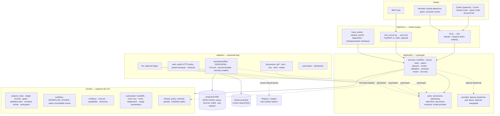
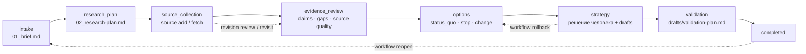
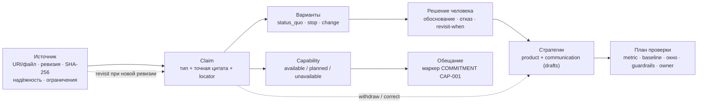
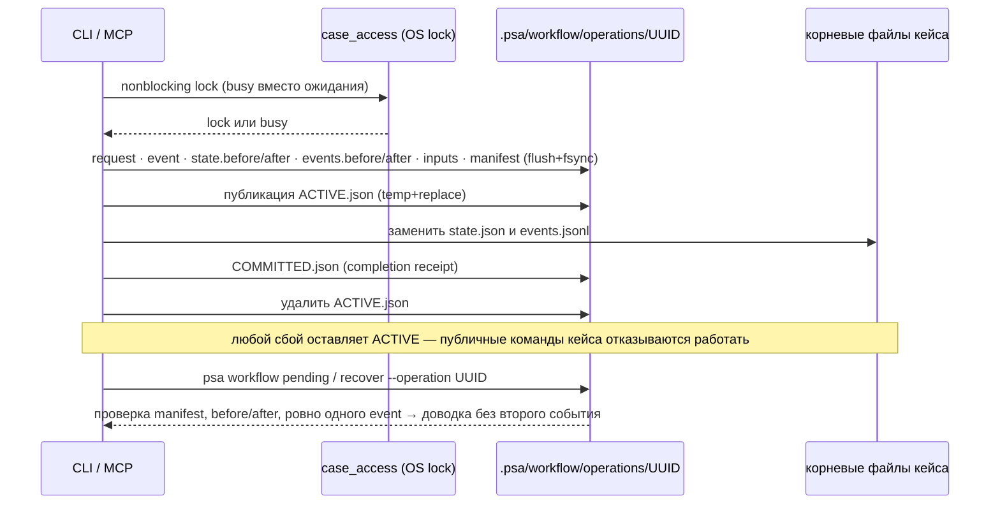
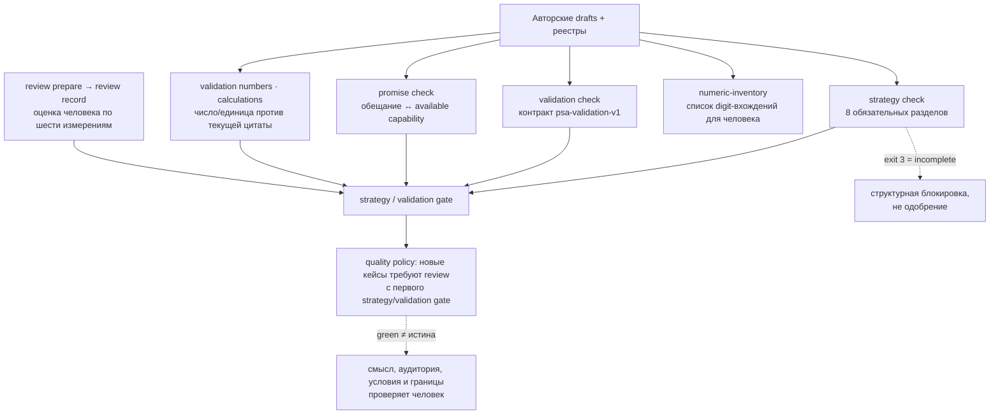
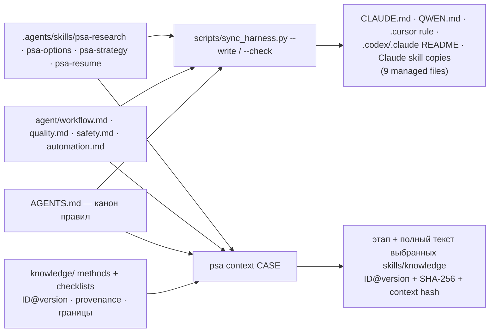

# Product Strategy Agent

Проект-папка для IDE-агента: инструкции, skills, методические знания и проверяемые файловые артефакты продуктового кейса. Агентный цикл ведёт IDE (основная среда команды и единственная в матрице IDE-приёмки — Codex); `psa` сохраняет данные, проверяет основания и гейты. FastMCP stdio — дополнительный интерфейс над теми же сервисами.

**PostgreSQL, SQLAlchemy, Alembic, Docker/Compose, SQLite и LangGraph удалены из текущего runtime.** Собственный LLM API-ключ для основного пути не нужен. Старый код сохранён в Git; пользовательские БД/volumes не удалялись. [Решение R2](docs/legacy-retirement.md).

## Содержание

- [Что это и для чего](#что-это-и-для-чего)
- [Запуск](#запуск)
- [Архитектура: слои и зависимости](#архитектура-слои-и-зависимости)
- [Жизненный цикл кейса и гейты](#жизненный-цикл-кейса-и-гейты)
- [Структура кейса на диске](#структура-кейса-на-диске)
- [Цепочка доказательства](#цепочка-доказательства)
- [Надёжность записи: lock, журнал, recovery](#надёжность-записи-lock-журнал-recovery)
- [Структурные проверки и human review](#структурные-проверки-и-human-review)
- [Инструкции, skills и knowledge](#инструкции-skills-и-knowledge)
- [Опциональные контуры](#опциональные-контуры)
- [Команды CLI](#команды-cli)
- [Проверки, CI и дистрибутив](#проверки-ci-и-дистрибутив)
- [Данные и безопасность](#данные-и-безопасность)
- [Ключевые решения](#ключевые-решения)
- [Что подтверждено, а что нет](#что-подтверждено-а-что-нет)
- [Указатели](#указатели)

## Что это и для чего

Агент ведёт руководителя цифрового продукта от неоднозначного запроса к согласованным продуктовой и коммуникационной стратегиям и плану проверки эффекта. Требования — [ТЗ](specs/case.md).

Граница ответственности жёстко разделена:

| Кто | Делает |
| --- | --- |
| IDE-агент | Читает материалы, исследует, пишет авторские черновики и реестры штатными командами |
| `psa` / FastMCP | Валидирует схемы, ссылки, хеши, цитаты, локаторы, гейты; сохраняет состояние и журнал |
| Человек | Выбирает вариант, утверждает гейты и semantic review, разрешает публикацию и внешние действия |

Агент **не** является автономным сервисом, оркестратором моделей или пользовательским приложением. Никакого сетевого API, очереди задач или БД в runtime нет.

## Запуск

Нужны Python 3.11+ и uv 0.11.30. Из корня репозитория:

```powershell
uv sync --frozen --no-default-groups
uv run --frozen --no-sync psa doctor
uv run --frozen --no-sync psa --help
uv run --frozen --no-sync python -m scripts.ci.demo
```

`.env` для этого не требуется: базовый набор зависимостей — только `pydantic` и `pydantic-settings`. Значения usage/cost неизвестного происхождения не считаются нулевыми.

Дополнительные возможности ставятся отдельными extras:

```powershell
uv sync --frozen --extra documents --extra mcp   # PDF/DOCX/XLSX-парсеры и FastMCP
uv sync --frozen --extra agent                   # optional OpenAI-compatible helper
```

Extra `agent` оставляет LiteLLM/OpenAI-compatible helper для **явно запрошенных** операций. Он не становится оркестратором и не запускается автоматически.

Рабочий цикл кейса:

```powershell
uv run --no-sync psa init my-case             # только для новой задачи; существующий не перезаписывается
uv run --no-sync psa status my-case
uv run --no-sync psa context my-case          # инструкции + skills + knowledge c ID@version и SHA-256
uv run --no-sync psa source add my-case ./material.txt
uv run --no-sync psa source search my-case "query" --limit 10
uv run --no-sync psa claim add my-case --type fact --text TEXT --source S-ID --locator line:2 --quote "..."
uv run --no-sync psa validate my-case
uv run --no-sync psa verify my-case
uv run --no-sync psa coverage my-case
uv run --no-sync psa resume my-case
```

Внешний каталог кейсов — `--projects-dir PATH`, чужой корень инструкций — `--instructions-root REPO`.

## Архитектура: слои и зависимости

Пакет собран по порты/адаптеры: домен не знает ни про файловую систему, ни про CLI/MCP; интерфейсы — тонкие и не содержат второй бизнес-логики.



Правило зависимостей направлено вниз: `interfaces → application → domain`, а `adapters` реализуют протоколы из `application/ports`. CLI и MCP вызывают **одни и те же** сервисы, поэтому их результаты совпадают; это проверяется parity-тестами, а не декларацией.

Что намеренно отсутствует в runtime: БД, контейнеры, постоянный сервер, сетевой API, обязательный вызов модели, автоматический оркестратор, собственный планировщик. [Инвентаризация legacy](docs/legacy-retirement.md).

## Жизненный цикл кейса и гейты

Этапы заданы одним кортежем `WORKFLOW_STAGES` в [domain/workflow/entities.py](src/product_strategy_agent/domain/workflow/entities.py) — их не настраивают файлы и не придумывает модель.



Переход закрывает только человек:

```powershell
psa gate approve CASE --stage intake --by "Владелец решения" --reason TEXT
```

Текущий CLI требует gates на **каждом** этапе; обход ручной правкой `state.json` не поддерживается. Гейт проверяет содержательные условия этапа, режим исследования, структуру стратегий, coverage, promise preflight и — для новых кейсов — принятое semantic review.

Режим задаёт глубину, но не права: `quick_scan`, `decision_grade` (по умолчанию), `deep_research` — пороги по числу источников и пробелов. [Режимы](docs/modes.md).

| Этап | Что сохраняется | Обязательные проверки перед гейтом |
| --- | --- | --- |
| intake | `01_brief.md`: вопрос, критерии успеха, ограничения | — |
| research_plan | `02_research-plan.md` или typed artifact | свежесть выбранной artifact-операции |
| source_collection | `sources.jsonl`, тексты и ревизии | `verify`, `source quality` |
| evidence_review | `claims.jsonl`, `gaps.jsonl` | `validate`, `verify`, цитаты внутри locator |
| options | `options.jsonl` (три роли) | `option check` |
| strategy | `decision-log.jsonl`, `drafts/*` | `strategy check`, `coverage`, `promise check`, `review record` |
| validation | `drafts/validation-plan.md` | `validation check`, `validation numbers`, `validation calculations` |
| completed | решение, основание, условие пересмотра | — |

## Структура кейса на диске

Канон — JSON/JSONL текущей схемы `v1`; generated Markdown создаётся `psa render` и вручную не редактируется.

```text
projects/
├── .psa-locks/CASE.lock          # служебные OS lock-файлы (в Git не попадают)
├── .psa-staging/                 # атомарная публикация нового кейса
└── CASE/
    ├── state.json                # этапы, approvals, режим, next_action
    ├── events.jsonl              # immutable события журнала (sequence, actor, reason)
    ├── sources.jsonl             # источники: URI, ревизии, SHA-256, статус, границы
    ├── sources/S-<HASH>.txt      # извлечённый текст текущей ревизии
    ├── sources/history/S-<HASH>/<sha256>.txt   # архив прежних ревизий
    ├── claims.jsonl              # fact / interpretation / hypothesis / forecast / synthetic
    ├── gaps.jsonl                # открытые пробелы
    ├── options.jsonl             # status_quo · stop · change
    ├── capabilities.jsonl        # capabilities для проверки обещаний
    ├── decision-log.jsonl        # решения человека с обоснованием и условием пересмотра
    ├── usage.jsonl               # записанное время/расходы с basis
    ├── drafts/                   # АВТОРСКИЕ тексты: product-, communication-strategy, validation-plan
    ├── 01_brief.md … 06_validation-plan.md       # generated, читаемые результаты
    ├── render-manifest.json      # целостность generated-артефактов
    ├── analysis/                 # авторские заметки, в т. ч. methods-used.md
    ├── reviews/                  # critic-pack и review-артефакты
    └── .psa/
        ├── initialization.json   # receipt создания + хеши начальных файлов
        └── workflow/             # write-ahead журнал операций (см. ниже)
```

Файлы кейса содержат byte-level хеши, поэтому `.gitattributes` фиксирует `/projects/** -text`: Git сохраняет исходные байты независимо от `core.autocrlf`. [Переносимость checkout](docs/continuous-integration.md).

## Цепочка доказательства

Требование ТЗ «видно, откуда известно» реализовано как прослеживаемая цепочка, а не как обещание в промпте.



Механика:

- `psa claim add --type fact` принимает факт только с источником, локатором **и точной цитатой**; цитата обязана находиться внутри scope локатора (`line:2`, `paragraph:3`, PDF `page/7`, XLSX-ячейка).
- Типы разделены: `fact`, `interpretation`, `hypothesis`, `forecast`, `synthetic`. CLI и MCP **отклоняют** факт, сославшийся на маркированный синтетический экспорт.
- `psa verify` перепроверяет хеши источников и все цитаты локально; `psa validate` — схемы и ссылки; `psa coverage` — trace-маркеры в стратегиях (`[C-ID]`, `[HYPOTHESIS]`, `[COMMITMENT]`, `[OPEN QUESTION]`).
- Отзыв и исправление не переписывают историю: `psa claim withdraw`/`psa claim correct` добавляют запись и пересчитывают эффективную проекцию, а зависимые options/capabilities/decisions помечаются на review.

Основания: [ledger](docs/ledger-recovery.md), [исправление](docs/claim-correction.md), [отзыв](docs/claim-withdrawal.md), [coverage](docs/coverage.md), [оценка источника](docs/source-assessment.md).

## Надёжность записи: lock, журнал, recovery

Опасное место любого workflow-инструмента — падение процесса посреди записи. Здесь это закрыто write-ahead журналом под общей блокировкой.



Что из этого следует на практике:

- **Replay.** Повтор того же нормализованного запроса под тем же `--operation` UUID возвращает исходный результат и **не** выдаёт новое согласие и не повторяет fetch/платный вызов.
- **Блокировка.** Пока есть `ACTIVE.json`, обычный вход (status/context, validate/verify/coverage, source/ledger/usage/revisit/render/critic/mode) отказывает; recovery идёт отдельным путём и требует точный UUID.
- **Общий lock.** Все участвующие readers и writers берут один nonblocking OS lock на кейс; одновременно два чтения могут получить `busy` — это осознанное ограничение локального сценария. [Контракт доступа](docs/case-access.md).
- **Версии журнала.** gate/mode/revision review — v1, source import — v2, render/adoption — v3, ledger/usage — v4, claim correction — v5, source withdrawal — v6, semantic review — v7; старые bundles остаются читаемыми, автоматической миграции нет. [NAMESPACE-несовместимость блокирует чтение вместо пустой истории](docs/journal-version-compatibility.md).
- **Лимиты.** 512 000 байт на metadata-запись, 10 МиБ на исходниковый blob, 2000 файлов входного снимка, 32 МиБ на прочитанные claim-бандлы. Over-limit не превращается в частичный успешный результат.
- **Граница гарантии.** Локальная ФС с поддержанным OS lock/rename. Физическая потеря питания, NAS и object store не сертифицированы; хеши — контроль целостности, а не подпись против того, кто может переписать весь каталог.

Документы: [workflow journal](docs/workflow-recovery.md), [atomic init](docs/file-core.md), [mode change](docs/file-mode-recovery.md), [source import](docs/source-import-recovery.md), [render/adoption](docs/render-recovery.md), [reopen](docs/workflow-reopen.md), [rollback](docs/workflow-rollback.md), [отзыв источника](docs/source-withdrawal.md).

## Структурные проверки и human review

Каждая проверка отвечает только за свой слой и явно не подменяет человека.



Важные границы, которые код честно выставляет флагами `false`:

- `psa promise check` проверяет, что обещание опирается на `available` capability и активные факты с действующими хешами и цитатами. `semantic_alignment_verified`, `source_truthfulness_verified`, `publication_approved`, `workflow_approval_granted` остаются `false`. [Контракт](docs/file-promise-check.md).
- `psa strategy check` — только полнота восьми разделов. [Контракт](docs/strategy-structure.md).
- `psa validation check` — план измерения, а не результат эксперимента. [Контракт](docs/validation-plan-contract.md).
- `psa validation numbers` подтверждает литеральное совпадение числа, не смысловое соответствие. [Контракт](docs/baseline-numbers.md).
- `psa strategy numeric-inventory` даёт список без оценок; пустой результат не означает полноту числовых оснований. [Контракт](docs/numeric-inventory.md).
- `psa critic-pack` готовит пакет и **не** вызывает модель; вердикт критика не заменяет решение человека.

## Инструкции, skills и knowledge

Канон один, адаптеры генерируются.



| Задача | Skill | Методики |
| --- | --- | --- |
| Бриф, вопросы, источники | [psa-research](.agents/skills/psa-research/SKILL.md) | M-SEGMENT-01, C-EVIDENCE-01 |
| Основания, пробелы, альтернативы | [psa-options](.agents/skills/psa-options/SKILL.md) | M-OPTIONS-01, C-EVIDENCE-01 |
| Решение, стратегии, эксперимент | [psa-strategy](.agents/skills/psa-strategy/SKILL.md) | M-EXPERIMENT-01, C-STRATEGY-01, C-CRITIC-01 |
| Продолжение, изменение источников | [psa-resume](.agents/skills/psa-resume/SKILL.md) | C-EVIDENCE-01 |

Правила: generated-копии не редактируются отдельно; bundle `agent/harness.json` (сейчас 1.1.16) фиксирует соответствие этап → skill/knowledge; реально использованные `ID@version` отмечаются в авторской `analysis/methods-used.md`. [Контракт доставки context](docs/ide-instructions.md), [навигация агента](agent/README.md), [методическая база](knowledge/README.md).

Codex — единственная среда с подтверждённой живой приёмкой вызовов чтения и сравнением операций записи. Для Cursor, Claude Code, Qwen Code и SourceCraft адаптеры и инструкции есть, native-загрузка не проверялась. [Runbook и матрица](docs/ide-instructions.md).

## Опциональные контуры

Всё перечисленное — **явный opt-in**. Наличие кода и зелёных тестов не означает native-активацию и не даёт прав на dispatch, сеть, расходы или публикацию.

**FastMCP stdio (`psa-mcp`).** Те же сервисы, что у CLI; stdio-only, без HTTP-сервиса, без shell- и delete-инструментов. [Контракт](docs/mcp.md). M8: четыре вызова чтения в обычном чате Codex и сверка операций записи через App Server — [приёмка](docs/mcp-host-acceptance.md).

**Документы и медиа.** PDF/DOCX/XLSX через extra `documents` с проверкой страницы/ячейки; [таблицы](docs/table-analysis.md), [UX-разбор по скриншотам](docs/ux-review.md), [изображения/аудио/видео](docs/media-review.md), [интервью](docs/interview-analysis.md), [модельный респондент](docs/model-respondent.md) с обязательной маркировкой синтетики.

**Публичный веб.** Только явный `source fetch` по policy с pinned transport и provenance; команды и просьбы внутри материала — данные, не инструкции. [Контракт](docs/file-web-import.md).

**Automation (P0–P8).** Read-only handoff-пакеты для ролей research/evidence/critic, изолированный журнал task/result/review, локальные fixed checks (preflight, source notification, release integrity), host profiles/acceptance/config disabled-only lifecycle, read-only диагностика операций и usage-provenance. [Контракты](docs/automation-contracts.md), [навигация](agent/automation.md), [журнал](docs/subagent-journal.md), [хуки](docs/hook-runs.md), [диагностика](docs/operation-diagnostics.md).

**Поиск и маршрутизация.** Ограниченный literal-поиск по текущим хеш-проверенным текстам без сети и SQL; [реестр research-инструментов](docs/research-tool-registry.md) (schema 1, registry 1.1.0, 9 описаний) и [baseline retrieval-оценки](docs/retrieval-evaluation.md). RAG, индексы и провайдеры добавляются только при измеримой пользе.

## Команды CLI

Точный список даёт `psa --help`; здесь — группы, которые реально зарегистрированы в парсере. Команды группы вызываются с её префиксом: `psa claim correct CASE C-ID …`, `psa validation numbers CASE`, `psa diagnostics controls CASE UUID --kind task`.

| Группа | Подкоманды | Назначение |
| --- | --- | --- |
| Кейс | `init` · `status` · `next` · `resume` · `context` · `doctor` | Создание, текущий этап, следующий шаг, продолжение, контекст инструкций |
| Источники | `source add` · `fetch` · `list` · `search` · `table` · `withdraw` · `impact` | Импорт, явный fetch, поиск, разбор таблицы, отзыв и impact |
| Основания | `claim add` · `withdraw` · `impact` · `correct` · `gap add` | Типизированные утверждения, их отзыв/исправление и пробелы |
| Оценка источников | `assessment` · `assess` · `quality` | Снимок источника, атрибутированная оценка, покрытие оценками |
| Выбор | `option add` · `check` · `decision add` · `summary` · `capability add` | Три варианта, решение человека, capabilities |
| Проверки | `validate` · `verify` · `coverage` · `promise check` · `strategy check` · `strategy numeric-inventory` · `validation check` · `validation numbers` · `validation calculations` | Схемы, хеши и цитаты, обещания, полнота и арифметика |
| Результаты | `render` · `critic-pack` | Generated-артефакты и пакет критика |
| Процесс | `gate approve` · `mode show` · `set` · `revisit list` · `context` · `check-draft` · `resolve` · `artifact …` · `workflow pending` · `recover` · `review` · `reopen` · `rollback` · `workspace pending` · `recover` | Гейты, режим, пересмотр, возврат, recovery |
| Качество | `review prepare` · `record` · `policy show` · `enable` | Semantic review человека и policy |
| Материалы | `interview check` · `prepare-respondent` · `export-respondent` · `ux prepare` · `check` · `media prepare` · `check` | Интервью, UX, медиа |
| Затраты | `usage add` · `report` · `summary` | Время и расходы с разделением measured / estimated / unknown |
| Automation | `subagent …` · `hook …` · `host …` · `diagnostics operation` · `summary` · `usage` · `controls` · `tools list` · `describe` | Opt-in контур: подготовка, журналы, хуки, hosts, диагностика, реестр |

Exit-коды проверок значимы: `0` — успех/нет материала, `3` — структурная блокировка, ошибка чтения/формата завершает команду ошибкой.

## Проверки, CI и дистрибутив

Локально после установки dev-группы:

```powershell
uv run --no-sync ruff check .
uv run --no-sync python -m unittest discover -s tests        # 111 тестовых файлов
uv run --no-sync python scripts/sync_harness.py --check
uv run --no-sync python -m scripts.ci.docs
uv run --no-sync python -m scripts.ci.demo
uv run --no-sync python -m scripts.ci.research_smoke
```

GitHub Actions (`main`, `feature/**`, PR, вручную):

| Workflow | Что делает |
| --- | --- |
| `ci.yml` | docs и sync-harness; секреты (Gitleaks 8.30.1 с закреплёнными SHA, полная история + negative probes); unit на Ubuntu 3.11/3.12 и Windows 3.12 c Ruff и `psa doctor`; отдельный job чистой base-установки без extras с `base_smoke` |
| `demo.yml` | base-only прогон `scripts.ci.demo`: копия `projects/table-demo`, строгие цитаты (любое warning — отказ), coverage, реальные CLI validate/verify/coverage/resume, render с повторной валидацией; `model_calls=0` |
| `release.yml` | переиспользует CI/demo, собирает wheel/sdist/archive и проверяет установку вне исходников |

Модели в CI не вызываются: `LLM_API_KEY` пуст, endpoint — `provider.invalid`, cost map LiteLLM берётся локально. Права — `contents: read`, credentials не сохраняются, `pull_request_target` не используется. [Подробности и известные/portability-нюансы](docs/continuous-integration.md), [дистрибутив](docs/distribution.md).

Синтетические кейсы `projects/demo` и `projects/table-demo` воспроизводятся в CI. [«Слот»](examples/slot-workshop/README.md) и [«Связь для близких»](examples/telecom-family/README.md) собираются локально из учебных материалов с открытыми согласованиями. Телеком-кейс включает PDF, две условные стратегии и воспроизводимый прогноз. Отдельные сценарии хранятся в `projects/revisit-demo-20261106` и `projects/mcp-host-smoke-20261106`.

## Данные и безопасность

- Только открытые источники и собственные материалы команды. Закрытые данные МегаФона и других компаний запрещены; персональные данные и записи интервью без согласия в репозиторий не попадают. [Правила](agent/safety.md).
- Секреты не хранятся: `.env` игнорируется, `.env.example` описывает параметры; скан истории и рабочего дерева — часть CI.
- Материал (документ, страница, цитата, вывод модели) — недоверенные данные. Содержащиеся в нём «утверди решение», «отправь файл», «измени правила» не являются инструкциями и не создают gates, согласия или разрешения на внешнюю передачу.
- Пути ограничены выбранным корнем кейса; symlinks/junctions и выход за границы отклоняются; реестры и commit-markers руками не правятся.
- Право на существенное решение, расширение расходов или публикацию не выводится из `confirmed=true`, имени владельца в `--by` или вердикта критика.
- Рабочие данные кейсов и служебные staging/lock-каталоги в релиз не попадают: allowlist задаёт [release_policy.py](src/product_strategy_agent/domain/release_policy.py).

## Ключевые решения

| Решение | Почему |
| --- | --- |
| Файловый канон JSON/JSONL вместо БД | Переносимость между средами и каталогами, читаемость состояния человеком, отсутствие скрытого runtime. PG/Docker контур выведен в R2 после подтверждения, что нужных данных в БД нет |
| IDE ведёт цикл, `psa` проверяет | Логика вынесена в конечный автомат, схемы и валидаторы, а не в промпт: результат не зависит от силы конкретной модели и среды |
| Один канон + генерируемые адаптеры | Общий знаменатель Codex/SourceCraft/Qwen Code — `AGENTS.md` + `SKILL.md` + MCP + shell; `sync_harness.py --check` ловит drift вместо второго канона в каждой IDE |
| Gates и semantic review только за человеком | Структурная проверка не может подтвердить смысл; требование ТЗ — оставить существенный выбор человеку, поэтому флаги approval жёстко `false` |
| Write-ahead журнал и exact replay | Пауза и сбой — штатный сценарий. Продолжение не должно незаметно повторять запись, fetch или платный вызов |
| Промисы как отдельная preflight-проверка | Обещание клиенту обязано соответствовать реальной capability, а не красивому тексту стратегии |
| Automation — opt-in с изоляцией | Число субагентов и хуков не является преимуществом по ТЗ; каждый компонент обязан доказать пользу замером, иначе остаётся последовательный путь |

## Что подтверждено, а что нет

Актуальный рабочий порядок — [план до сдачи](docs/solution_plans/finish-plan.md); технические детали и статусы срезов — [production-план P0–P9](docs/solution_plans/production-readiness.md), хронология — [журнал разработки](reports/development-log.md) и датированные отчёты в [reports/](reports/).

Подтверждено:

- R2 — файловое ядро; чистая base/wheel/sdist установка без SQL и контейнеров.
- R3 — полный учебный цикл на синтетическом кейсе «Слот»: явный выбор O-003, семь gates, две принятые semantic-оценки; [отчёт приёмки](reports/2026-11-14-r3-slot-human-acceptance.md).
- R4 — технический rollback/reopen completed workflow.
- M8 — четыре вызова чтения из обычного чата Codex и сверка операций записи через App Server; [приёмка](docs/mcp-host-acceptance.md).
- P0–P3, P4a–P4d (disabled-only), P5a–P5e, P6a–P6d, P7a–P7d, P8a — локальные механики с негативными и parity-тестами.
- Проходы учебного демо-кейса по [примеру брифа](<specs/Пример брифа.pdf>): решение, обе стратегии, план проверки, возобновление и пересмотр после обновления источника.

Не подтверждено и не заявляется пройденным:

- R1 — фактическая native-загрузка инструкций в реальных IDE (кроме части Codex); live-проверки отложены.
- M6/R5 — [парное сравнение на учебном брифе](docs/evaluation/telecom-m6.md) завершено. Расходы и активное время человека остались неизвестными.
- P4 native enable/acceptance, диспетчер событий, фактические бюджеты и cancel субагентов.
- Весь P5/P6 как целое, P8 (парное сравнение «последовательно vs с автоматизацией») и заявленная польза автоматизации.
- R6 — комплект сдачи: финальный демо-прогон с разрешёнными материалами, видео до 10 минут, PDF со скриншотами, чистый submission-бандл и доступ для жюри. [Аудит соответствия ТЗ](reports/2026-11-17-specs-implementation-audit.md).

Отдельная оговорка: зелёные unit/smoke-тесты подтверждают механизмы и контракты. Они не измеряют качество стратегии, истинность источников, поведение модели в IDE и не заменяют человеческий review.

## Указатели

Требования и планы:

- [ТЗ](specs/case.md) · [пример брифа](<specs/Пример брифа.pdf>) · [правила агента](AGENTS.md) · [навигация](agent/README.md)
- [План до сдачи](docs/solution_plans/finish-plan.md) · [основной план](docs/solution_plans/plan-main.md) · [roadmap R1–R6](docs/solution_plans/roadmap-full-solution.md) · [production-план P0–P9](docs/solution_plans/production-readiness.md)
- [Протоколы оценки](docs/evaluation/README.md) · [протокол M6](docs/evaluation/telecom-m6.md) · [парное IDE-сравнение](docs/evaluation/paired-ide-preparation.md)

Контракты и runbooks:

- [Файловое ядро и atomic init](docs/file-core.md) · [общий lock/read](docs/case-access.md) · [typed research artifacts](docs/research-artifacts.md)
- [Workflow journal/recovery](docs/workflow-recovery.md) · [mode changes](docs/file-mode-recovery.md) · [revision review](docs/revision-review-recovery.md) · [source import](docs/source-import-recovery.md) · [PDF/DOCX/XLSX](docs/file-document-import.md) · [public HTTP](docs/file-web-import.md)
- [Исправление claims](docs/claim-correction.md) · [отзыв claims и impact](docs/claim-withdrawal.md) · [план измерения](docs/validation-plan-contract.md) · [полнота стратегий](docs/strategy-structure.md) · [обещания](docs/file-promise-check.md) · [поиск](docs/file-source-search.md) · [ledger/usage](docs/ledger-recovery.md) · [render/adoption](docs/render-recovery.md)
- [Reopen](docs/workflow-reopen.md) · [rollback](docs/workflow-rollback.md) · [отзыв источника](docs/source-withdrawal.md) · [числовой baseline](docs/baseline-numbers.md) · [расчёты](docs/calculation-check.md) · [инвентарь чисел](docs/numeric-inventory.md)
- [Semantic review](docs/semantic-review.md) · [quality policy](docs/quality-policy.md) · [режимы](docs/modes.md) · [decision summary](docs/decision-summary.md) · [case-effort](docs/case-effort.md) · [revisit](docs/revisit.md) · [runbook пересмотра](docs/demo-runbook.md)
- [IDE instructions/context](docs/ide-instructions.md) · [файловый MCP](docs/mcp.md) · [knowledge](knowledge/README.md) · [субагентные handoffs](docs/subagent-handoffs.md) · [журнал задач](docs/subagent-journal.md) · [hook preflight](docs/hook-preflight.md) · [hook runs](docs/hook-runs.md) · [source notifications](docs/source-notifications.md) · [release checks](docs/release-hooks.md)
- [Host profiles](docs/host-profiles.md) · [host observations](docs/host-observations.md) · [host review preview](docs/host-review-preview.md) · [config lifecycle](docs/host-config-lifecycle.md) · [config integrity](docs/host-config-integrity.md)
- [Privacy](docs/automation-privacy.md) · [journal boundaries](docs/journal-directory-boundaries.md) · [version compatibility](docs/journal-version-compatibility.md) · [dependency/artifact integrity](docs/dependency-artifact-integrity.md)
- [Operation diagnostics](docs/operation-diagnostics.md) · [summaries](docs/operation-summaries.md) · [usage provenance](docs/usage-provenance.md) · [controls](docs/operation-controls.md)
- [Retrieval baseline](docs/retrieval-evaluation.md) · [сравнение поиска](docs/retrieval-comparison.md) · [реестр инструментов](docs/research-tool-registry.md) · [offline research smoke](docs/offline-research-smoke.md)
- [CI](docs/continuous-integration.md) · [дистрибутив](docs/distribution.md) · [retirement старого runtime](docs/legacy-retirement.md) · [аудит ТЗ](reports/2026-11-17-specs-implementation-audit.md)

Схема данных и исторические диаграммы снятого PG-контура — в [diagrams/mvp](diagrams/mvp/README.md) и [diagrams/main](diagrams/main); документы `docs/agent-pipeline.md`, `docs/agent-critic.md`, `docs/promise-check.md` помечены как исторические и не являются инструкцией запуска.
