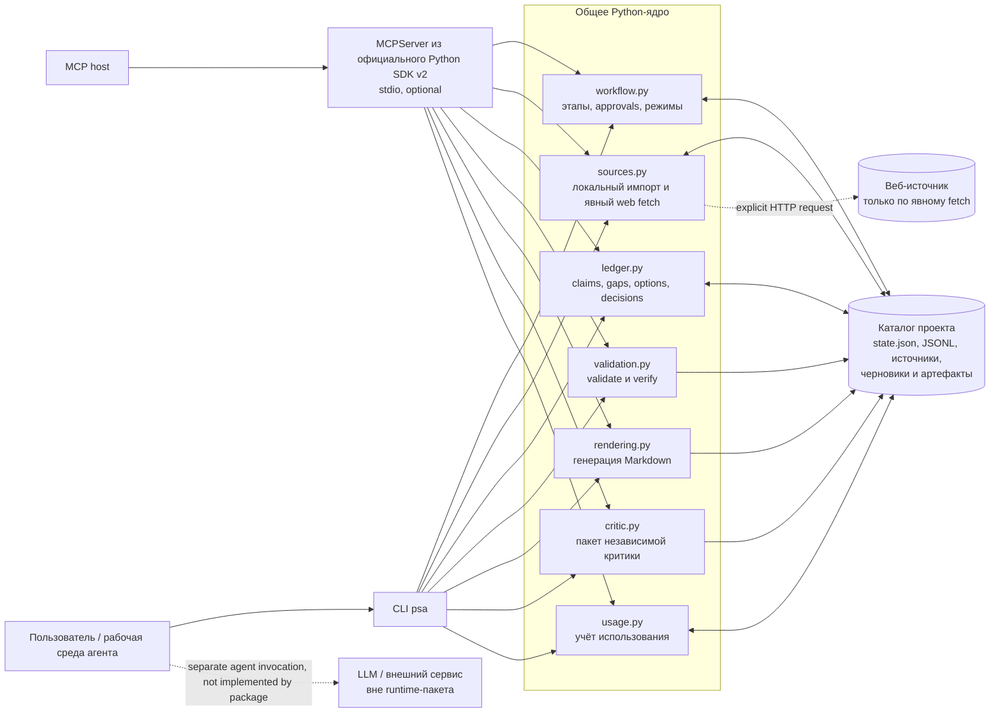

# Архитектура MVP

CLI и MCP вызывают одни Python-функции. MCP-сервер не содержит отдельной бизнес-логики. Файловое состояние проекта сохраняет переносимость между средами; SQLite, удалённый API-сервер и автоматический router моделей в MVP не включены.
