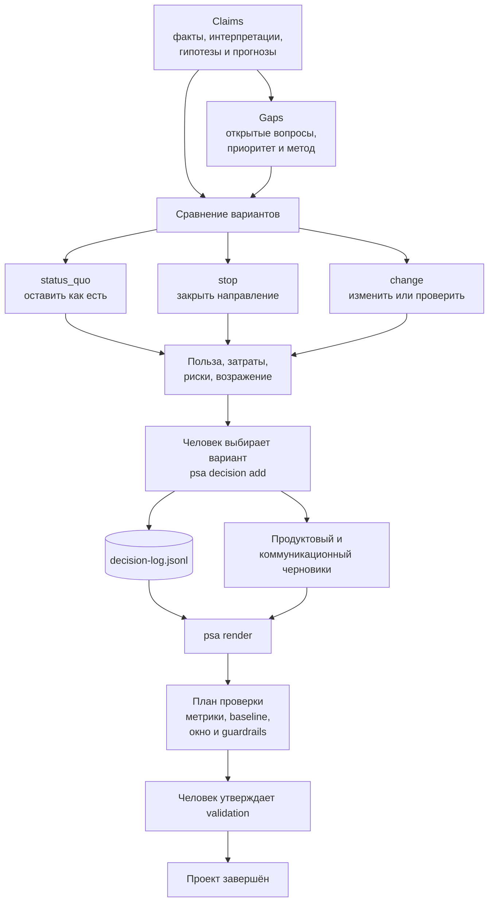

# Варианты и человеческое решение

Система формирует сравнимые материалы и сохраняет владельца решения, основания, отклонённые варианты, риски и условие пересмотра. Она не принимает решение вместо человека.
