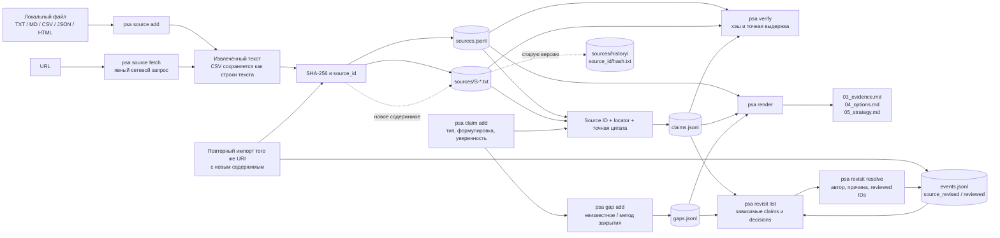

# Источники и доказательства

Локатор `line:N` адресует одну строку, `lines:N-M` — включительный диапазон строк, `paragraph:N` и `p:N` — непустой абзац. `verify` проверяет сохранённую копию и цитату, но сам по себе не подтверждает истинность источника.
