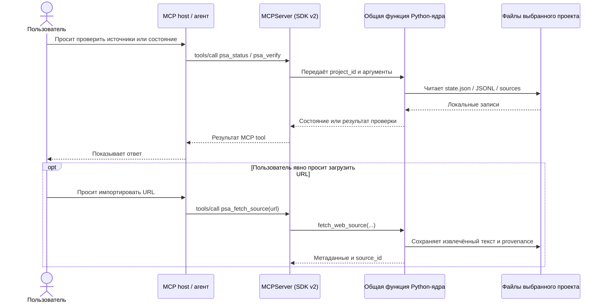

# Взаимодействие MCP

MCP stdio — необязательный интерфейс поверх существующих операций. Доступные tools и настройка host описаны в [docs/mcp.md](../../docs/mcp.md). Полноценная проверка подключений в целевых IDE — отдельный пункт плана.
