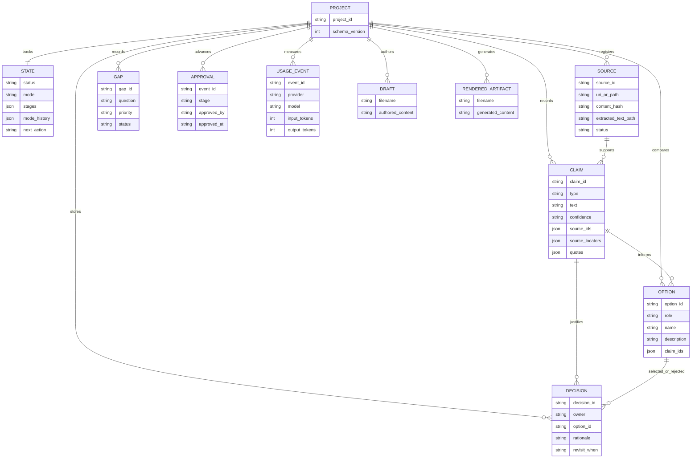

# Структура данных проекта

На диске `PROJECT` — каталог; состояние, approvals и mode history находятся в `state.json`, события source revision/review также дописываются в `events.jsonl`. Предыдущие извлечённые версии сохраняются в `sources/history/`. Остальные сущности хранятся в соответствующих JSONL-файлах, черновики — в `drafts/`, сгенерированные Markdown-файлы — в корне проекта. Связи в диаграмме показывают смысловые ссылки по ID, а не реляционную базу данных.
