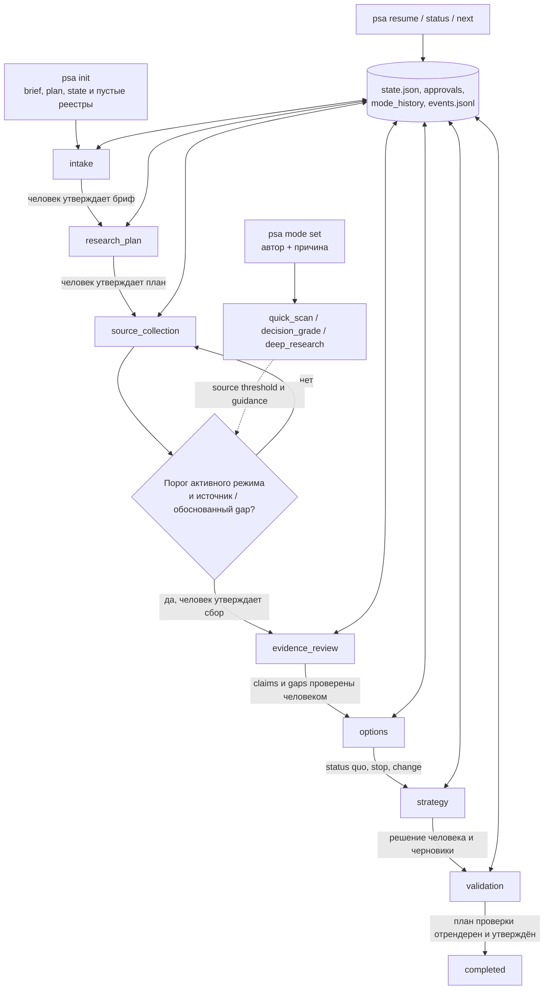

# Жизненный цикл проекта

`quick_scan` требует минимум один источник. `decision_grade` ориентируется на два, `deep_research` — на четыре; для двух последних допускается один источник и открытый пробел высокого приоритета. Каждое прохождение гейта требует автора; переходы не автоматические.
