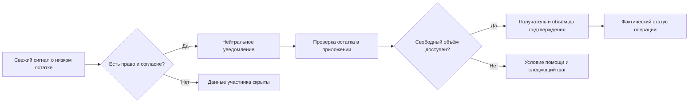

# Путь клиента и границы первой версии

Проектный сценарий для O-003. Первый пользователь — организатор семейной группы на одном совместимом тарифе. Второй участник управляет согласием на показ остатка.

| Момент | Что нужно человеку | Условие и ожидаемый результат |
| --- | --- | --- |
| До события | Понимать, кто увидит данные и зачем | Участник видит объём доступа и способ отзыва. |
| Низкий остаток | Узнать о риске вовремя | Сигнал относится к разрешённому номеру и актуальному остатку. При неоплате или неподтверждённой причине используют другой маршрут. |
| Вход в приложение | Разобраться, можно ли помочь | Сервис проверяет роль, согласие и доступный объём. |
| Подтверждение | Направить помощь нужному человеку | До операции видны получатель и объём. Выделение выполняется вручную. |
| После действия | Понять, произошло ли выделение | Статус расчётной системы различает успех, ожидание и отказ. |
| После отзыва | Скрыть остаток участника | Просмотр проверяется повторно при открытии приложения. |

**Граница первой версии.** Один тариф и один сценарий низкого остатка. Автовыделение, платежи, просмотр чужих начислений, новый общий кабинет и перенос на другие тарифы остаются за рамками. Для проверки нужны данные о своевременности сигнала и корректности ручной операции.

[Продуктовая стратегия](product-strategy.md) · [Сообщения и проверка понимания](message-test.md)
