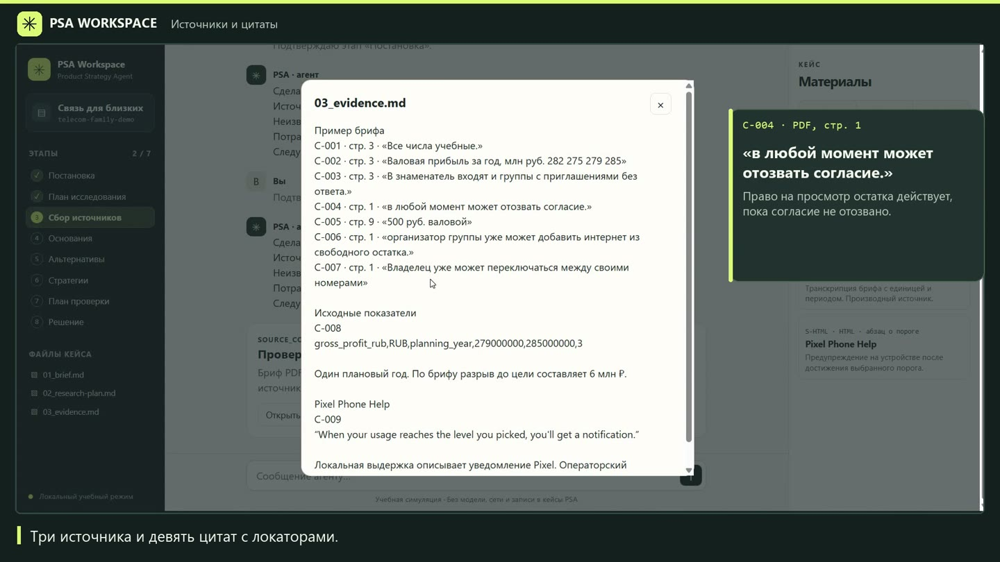
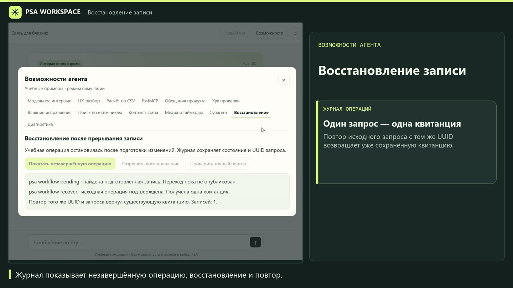

# Product Strategy Agent

Описание проекта для хакатона · Кейс Фабрики продуктов МегаФона · 22 ноября 2026

## Назначение и демонстрационный кейс

**Product Strategy Agent (PSA)** помогает руководителю цифрового продукта пройти путь от неоднозначного вопроса до проверяемой рекомендации, согласованных стратегий и плана измерения эффекта. Агент уточняет задачу, сопоставляет материалы, показывает основания и неизвестные, сравнивает варианты. Человек делает существенный выбор и подтверждает переходы.

В кейсе «Связь для близких» вымышленный оператор решает, кому помочь первым: организаторам семейных групп или владельцам нескольких собственных номеров. В исходной итерации выбран O-003 — проверить своевременное предупреждение о низком остатке на одном тарифе с доступным ручным выделением интернета. Входы — учебный PDF, CSV с пятью показателями из брифа и выдержка публичной справки Pixel. Числа оператора учебные.


*Кадр из видеодемо. Браузерная симуляция показывает тот же порядок действий на подготовленных данных.*

[Техническое задание](../specs/case.md) · [Исходники, продуктовая и коммуникационная стратегии](telecom-demo-project.md) · [Видео, 4 мин 38 с](demo-ui/psa-workspace-demo.mp4)

## Архитектура и знания


| Слой | Что делает |
| --- | --- |
| Среда и инструкции | Codex ведёт диалог и запускает инструменты. `AGENTS.md` задаёт общие правила. `psa context` отдаёт навыки и методики текущего этапа с версией и SHA-256. |
| Входы к сервисам | Python CLI и опциональный FastMCP по stdio обращаются к общим сценариям в `application/`. Правила этапов, утверждений и решений находятся в `domain/`. |
| Адаптеры | Локальные файлы, извлечение текста из документов и таблиц, импорт разрешённой публичной страницы. |
| Хранение и память | В `projects/CASE` отдельно хранятся бриф, источники, реестры JSONL, состояние, журнал операций и стратегии. Новый чат читает эти файлы. |
| База знаний | В `knowledge/` версионируются методики. Они помогают проверить вопрос, обещание и метрику. Подтверждение вывода сохраняется в конкретном кейсе. |

Канон инструкций общий. Копии для IDE формирует `scripts/sync_harness.py`. Базовый режим работает с локальной папкой и использует модель через IDE. Для него не нужны база данных, контейнеры и отдельный модельный API-ключ.

[Инструкции и доставка контекста](ide-instructions.md) · [База знаний](../knowledge/README.md) · [Файловое ядро](file-core.md)

## Процесс и управление работой


1. **Постановка и исследование.** Зафиксировать вопрос решения и критерии. Сохранить материалы, цитаты, привязки, ограничения и пробелы. Для PDF привязка ведёт к странице, для CSV и текстовой выдержки — к строке или абзацу.
2. **Альтернативы.** Сравнить минимум три разных варианта, включая сохранение текущего положения и закрытие направления. Показать сильнейшее возражение к каждому.
3. **Решение и стратегии.** Записать выбор человека и подготовить продуктовую и коммуникационную стратегии. Сверить текст обещания с доступными действиями и условиями продукта.
4. **План проверки.** Определить метрику, сравнение, окно наблюдения, ответственного и условия остановки. Выполнить критический разбор. Человек отдельно подтверждает смысловую оценку и переход.
5. **Продолжение.** В новом чате прочитать этап, решение и следующий шаг. При новой ревизии источник сохраняется в истории, а зависимые выводы и решения помечаются для пересмотра.

`psa validate` проверяет структуру и связи, `psa verify` — целостность и точность цитат, `psa coverage` — привязку стратегий к основаниям и маркировку неопределённости.

[Рабочий процесс и согласования](../agent/workflow.md) · [Смысловая оценка](semantic-review.md) · [Пересмотр](revisit.md)

## Модели, сервисы и запуск

| Компонент | Назначение и условия |
| --- | --- |
| Codex и GPT-6.2 Sol | Основная среда и модель, запрошенная для сравнения M6 с уровнем reasoning medium. Модель исследует материалы и готовит черновики. Для живого прогона нужен доступ к Codex. |
| Python 3.11+, uv 0.11.30 | Установка и запуск CLI из lock-файла. Локальные проверки и воспроизведение готовых артефактов обходятся без вызовов модели. |
| FastMCP 4.x | Опциональные инструменты по stdio, например `psa_status` и `psa_verify`. Работа инструментов чтения подтверждена в Codex. |
| LiteLLM и Qwen | Опциональный клиент OpenAI-compatible провайдера для явно выбранных операций. `Qwen3.8-27B` проверялся в отдельном развёртывании. Доступ и стоимость зависят от провайдера. |
| pypdf, python-docx, openpyxl | Опциональное извлечение материала из PDF, DOCX и XLSX. CSV и локальные текстовые выдержки доступны в файловом пути PSA. |
| Публичные сайты | Явный HTTPS-импорт разрешённой страницы с сохранением локального снимка. Для офлайн-демо используется сохранённая выдержка Pixel. |
| PSA Workspace и GitHub | Статическое демо воспроизводит сценарий без модели. GitHub хранит код и запускает проверки CI, офлайн-демо и упаковки. |

Базовая проверка запуска из корня репозитория:

```powershell
uv sync --locked --no-default-groups
uv run --no-sync psa doctor
uv run --no-sync python -m scripts.ci.demo
```

[Запуск в Codex](codex-demo-guide.md) · [Приёмка MCP](mcp-host-acceptance.md) · [Проверка провайдера](model-provider-diagnostics.md)

## Ключевые промпты и инструкции

Примеры ниже сокращены для отчёта. Полный сценарий содержит отдельные реплики согласования и проверки актуальной версии материалов.

| Момент | Запрос или команда человеку и агенту |
| --- | --- |
| Старт | «Открой telecom-family-demo. Покажи вопрос решения, три материала с цитатами, гипотезы и неизвестные. Остановись перед согласованием». |
| Выбор | «Сравни четыре варианта. Покажи пользу, затраты, риски и сильнейшее возражение к каждому. Дождись моего выбора». |
| Подготовка результата | «Выбираю O-003. Подготовь обе стратегии и план проверки. Покажи границы обещания, числовые допущения и критерии оценки». |
| Продолжение | «Возобнови кейс из сохранённой папки. Покажи этап, последнее решение и следующий шаг. Не повторяй импорт и согласования». |



*Кадр из видеодемо. Маркеры показывают, где проверить источник и границы вывода.*

В инструкциях агенту предусмотрены команды человека «стоп», «исправь», «вернись на этап» и «появились новые данные». После этапа агент сообщает, что сделано, какие материалы использованы, что неизвестно, какие расходы известны и что делать дальше.

[Полные промпты](codex-demo-guide.md#2-запишите-сквозной-сценарий) · [Канон агента](../AGENTS.md)

## Дополнительный уровень

| Возможность | Что реализовано и как показано |
| --- | --- |
| Интервью и модельные респонденты | Гайд под вопрос решения, анализ разрешённого транскрипта и синтетические беседы для поиска гипотез. Гипотеза из модельного интервью показана в демо. |
| Изображения, аудио и видео | Привязки к координатам PNG и интервалам PCM WAV и MP4. Демо показывает область PNG. Содержание медиа оценивается после просмотра или прослушивания. |
| UX-анализ | Привязка наблюдения к экрану и шагу. В демо сравниваются подписи действий на двух учебных макетах. |
| Анализ данных | Воспроизводимые формулы, проверка единиц, периодов и пропусков. Два сценария прибыли пересчитываются по CSV. |
| Поддержка решения и пересмотр | Сводка связывает выбор, владельца и условие пересмотра. Ревизия показывает затронутые основания, прогноз и решение. |
| Поиск и контекст | Поиск по сохранённым выдержкам. Пакет инструкций и методик выбирается для текущего этапа. |
| Хуки и субагенты | Явный локальный хук проверяет готовность материалов. Роль `evidence` получает выбранные выдержки по отдельному поручению. В демо вызовы сценарные. |
| Восстановление | Незавершённую операцию видно в журнале. После явного восстановления повтор того же UUID и запроса возвращает сохранённую квитанцию. |



*Кадр из эпизода о восстановлении. Повтор возвращает ту же квитанцию.*

[Интервью](interview-analysis.md) · [Медиа](media-review.md) · [UX](ux-review.md) · [Хуки](hook-preflight.md) · [Субагенты](subagent-handoffs.md) · [Восстановление](workflow-recovery.md)

## Время, расходы и результаты

| Что измерено | Время | Модель и расходы |
| --- | --- | --- |
| Монтаж для сдачи | 4 мин 38 с | Хронометраж видео. |
| Базовая экранная репетиция | ≈ 3 мин 01 с от запроса до повторного завершения. Первая запись — 4 мин 51 с | Браузерная симуляция: 0 вызовов, 0 токенов, 0 ₽ на модель. Исходные материалы подготовлены заранее. |
| Техническая репетиция из ZIP | 50,517 с от проверки архива до сверки состояния | Установка с доступным кэшем, сборка и локальные проверки. Команды PSA в этом прогоне к модели не обращались. |
| M6 · Codex с PSA | 21 мин 33 с календарного времени, 18 мин 24 с суммарно по трём ходам | Токены, число вызовов модели, активное время человека и стоимость отдельно не зафиксированы. |
| M6 · обычный чат | 16 мин 48 с календарного времени, 5 мин 27 с суммарно по трём ходам | Та же граница измерений. Длительности ходов включают инструменты. |

В исходном отчёте M6 модельный рецензент поставил PSA **13/14**, обычному чату — **11/14**. В видео для PSA указано **14/14 по локальной перепроверке команды**. Числа относятся к одной учебной задаче. Прогоны частично пересекались, а чистое время модели и ручной работы раздельно не измерялось.

В первой технической попытке лишний флаг `--json` у `psa revisit list` вызвал ошибку. Команду повторили без него, и её результат сверили со снимком. В M6 человек выбрал вариант и подтвердил подготовительные этапы. В отдельном завершённом проходе подтверждены семь переходов и две смысловые оценки.

[Сравнение M6](evaluation/telecom-m6.md) · [Репетиция и проверка состояния](../reports/2026-11-21-telecom-demo-rehearsal.md)

## Ограничения и материалы для проверки


*Кадр браузерной симуляции. Новый чат читает сохранённые этап и решение. Согласования остаются в журнале.*

- **Границы демонстрации.** В видео показан учебный интерфейс с подготовленными материалами. Прогнозы относятся к вымышленному оператору. Эффект, спрос и производственные затраты требуют измерения.
- **Границы проверок.** Совпадение цитаты подтверждает привязку. Надёжность источника, обоснованность вывода и обещание проверяются отдельно. Синтетические реплики используются для гипотез.
- **Поддержка сред.** Живой проход и чтение FastMCP подтверждены в Codex. Для других IDE доступны инструкции подключения. Перенос между разными IDE в этом комплекте отдельно не подтверждён.
- **Данные и полномочия.** Используются открытые и разрешённые учебные материалы. Источники не выдают разрешений. Выбор решения, значимые переходы, запуск пилота и внешние действия подтверждает человек.

[Демонстрационный проект и обе стратегии](telecom-demo-project.md) · [Видео](demo-ui/psa-workspace-demo.mp4) · [Сверка с ТЗ](../reports/2026-11-22-specs-readiness-review.md)
