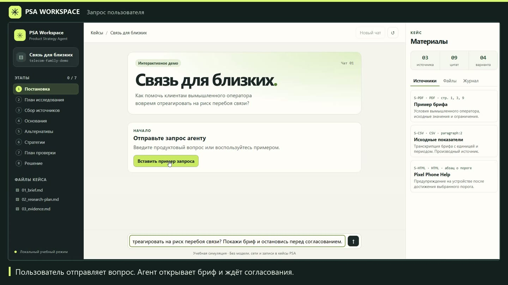
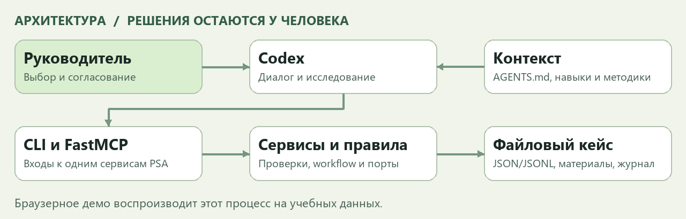
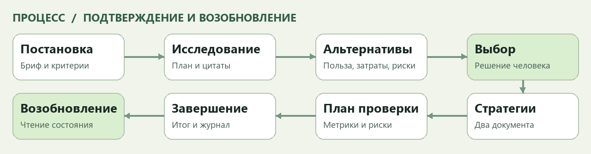
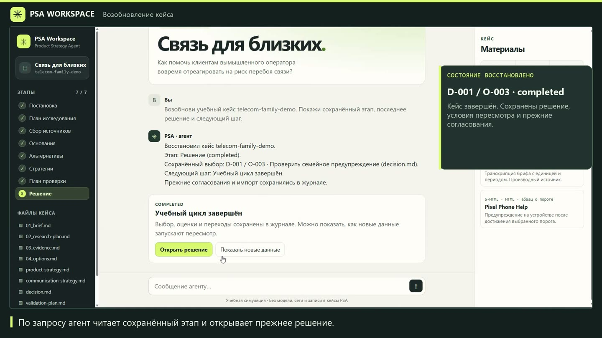

# Product Strategy Agent

Описание проекта для хакатона · Кейс Фабрики продуктов МегаФона · 22 ноября 2026

## Назначение и границы проекта

**Product Strategy Agent (PSA)** - переносимая папка для работы руководителя цифрового продукта в IDE с ИИ. Она объединяет инструкции, знания, инструменты и рабочие кейсы. Агент ведёт исследование, связывает рекомендации с источниками, сравнивает варианты, готовит продуктовую и коммуникационную стратегии и предлагает план измерения эффекта. Человек делает существенный выбор и подтверждает переходы.

Входом может быть новый продуктовый вопрос или сохранённый кейс. Выходом служит комплект читаемых документов и состояние, которое можно продолжить после перерыва. В демонстрации «Связь для близких» вымышленный оператор выбирает первый сценарий помощи со связью. В историческом проходе человек выбрал O-003, проверку семейного предупреждения. Отдельный файл содержит исходные материалы, сравнение вариантов, обе стратегии и план проверки.



*Кадр из видеодемо. Браузерная симуляция показывает тот же порядок действий на подготовленных данных.*

[Техническое задание](../specs/case.md) · [Исходники, продуктовая и коммуникационная стратегии](telecom-demo-project.md) · [Видео, 4 мин 38 с](demo-ui/psa-workspace-demo.mp4)

## Архитектура и знания



| Слой | Что делает |
| --- | --- |
| Среда и инструкции | Codex ведёт диалог и запускает инструменты. `AGENTS.md` задаёт общие правила. `psa context` отдаёт навыки и методики текущего этапа с версией и SHA-256. |
| Входы к сервисам | Python CLI и опциональный FastMCP по stdio обращаются к общим сценариям в `application/`. Правила этапов, утверждений и решений находятся в `domain/`. |
| Адаптеры | Локальные файлы, извлечение текста из документов и таблиц, импорт разрешённой публичной страницы. |
| Хранение и память | В `projects/CASE` отдельно хранятся бриф, источники, реестры JSONL, состояние, журнал операций и стратегии. Новый чат читает эти файлы. |
| База знаний | В `knowledge/` версионируются методики. Они помогают проверить вопрос, обещание и метрику. Подтверждение вывода сохраняется в конкретном кейсе. |

Канон инструкций общий. Копии для IDE формирует `scripts/sync_harness.py`. Базовый режим работает с локальной папкой и использует модель через IDE. Для него не нужны база данных, контейнеры и отдельный модельный API-ключ.

[Инструкции и доставка контекста](ide-instructions.md) · [База знаний](../knowledge/README.md) · [Файловое ядро](file-core.md)

## Структура репозитория и режимы работы

| Где | Ответственность |
| --- | --- |
| `AGENTS.md`, `agent/` | Единые инструкции, рабочий процесс, требования к качеству и правила данных. Генератор поддерживает согласованность адаптеров IDE. |
| `.agents/skills/`, `knowledge/` | Девять процедур по задачам и версионированные методики. Методика объясняет, как работать, а основание утверждения хранится в кейсе. |
| `src/product_strategy_agent/` | Интерфейсы CLI и MCP передают команды сервисам. Предметные правила, порты и адаптеры разделены. |
| `projects/`, `examples/` | Папки кейсов с локальным состоянием и материалы для сборки воспроизводимых учебных примеров. |
| `docs/demo-ui/` | Браузерный сценарий и 13 интерактивных эпизодов. Некоторые операции имитируются, расчёт и поиск выполняются локально. |
| `scripts/ci/`, `tests/`, `reports/` | Проверки, тесты и записи о фактической приёмке. |

**Живая работа.** В Codex модель исследует разрешённые материалы, а PSA выполняет файловые операции и технические проверки. Для нового кейса создаётся отдельная папка. После паузы продолжается тот же кейс.

**Офлайн replay.** Проверяются готовые учебные артефакты, цитаты, привязки и повторная сборка отчётов. Команда воспроизводит сохранённый результат без модели. Сценарий удобен для проверки установки.

**Демо в браузере.** Подготовленные реплики и ответы показывают, как выглядит путь пользователя. Учебный прогресс сохраняется в браузере. Он не экспортируется в живые файлы PSA.

[README и запуск](../README.md) · [Браузерное демо](demo-ui/README.md) · [Пакет установки](distribution.md)

## Как хранятся и проверяются решения

| Запись | Что нужно для проверки |
| --- | --- |
| Источник | ID, сохранённый материал и его хеш, ревизия, доступные автор и дата, ограничения и оценка надёжности. Дата доступа хранится отдельно от даты публикации. |
| Утверждение | Тип, ID источника, точная цитата и локатор. Факт, интерпретация, гипотеза, прогноз и синтетика различаются. Неизвестное сохраняется с объяснением, почему влияет на выбор и как его проверить. |
| Вариант и решение | Основания, польза, издержки, риски и сильнейшее возражение. Запись выбора содержит ответственного, причины отказа от альтернатив и условие пересмотра. |
| Черновики и отчёты | Авторские файлы находятся в `drafts/`. `psa render` собирает читаемые отчёты и контрольные суммы. Реестры и сгенерированные документы меняются штатными командами. |
| Согласование | На этапах стратегии и плана проверки оценка привязана к актуальному снимку. Критический разбор выявляет замечания. Решение о переходе записывает человек. |

**Ревизия и исправление.** При обновлении сохраняются прежние байты, источники и решения. `psa claim impact` и `psa revisit context` показывают затронутые выводы. Человек разрешает исправление, возврат или новый выбор. Прежнее согласование остаётся в истории.

**Незавершённая запись.** Локальная блокировка сериализует изменения. Журнал хранит подготовленные изменения и UUID операции. `psa workflow pending` показывает незавершённую запись, `psa workflow recover` восстанавливает выбранную операцию. Точный повтор того же запроса с тем же UUID возвращает сохранённую квитанцию.

**Границы безопасности.** Источники и результаты ролей читаются как данные. Новые внешние запросы, передача материалов, платные операции и публикация требуют явного разрешения. Секреты остаются в локальной конфигурации.

[Оценка источника](source-assessment.md) · [Исправление утверждения](claim-correction.md) · [Журнал и восстановление](workflow-recovery.md) · [Границы данных](../agent/safety.md)

## Процесс и управление работой



1. **Постановка и исследование.** Зафиксировать вопрос решения и критерии. Сохранить материалы, цитаты, привязки, ограничения и пробелы. Для PDF привязка ведёт к странице, для CSV и текстовой выдержки — к строке или абзацу.
2. **Альтернативы.** Сравнить минимум три разных варианта, включая сохранение текущего положения и закрытие направления. Показать сильнейшее возражение к каждому.
3. **Решение и стратегии.** Записать выбор человека и подготовить продуктовую и коммуникационную стратегии. Сверить текст обещания с доступными действиями и условиями продукта.
4. **План проверки.** Определить метрику, сравнение, окно наблюдения, ответственного и условия остановки. Выполнить критический разбор. Человек отдельно подтверждает смысловую оценку и переход.
5. **Продолжение.** В новом чате прочитать этап, решение и следующий шаг. При новой ревизии источник сохраняется в истории, а зависимые выводы и решения помечаются для пересмотра.

`psa validate` проверяет структуру и связи, `psa verify` — целостность и точность цитат, `psa coverage` — привязку стратегий к основаниям и маркировку неопределённости.

[Рабочий процесс и согласования](../agent/workflow.md) · [Смысловая оценка](semantic-review.md) · [Пересмотр](revisit.md)

## Контекст, навыки и полномочия

| Когда | Что читает и делает агент |
| --- | --- |
| Постановка `intake` | `psa-intake` фиксирует вопрос и задаёт до пяти необходимых уточнений. Методика сегментации помогает описать задачу клиента. |
| Исследование | `psa-research` строит план и работает с материалами. Для сбора и обзора в пакет попадает чек-лист доказательств. |
| Сравнение `options` | `psa-options` сопоставляет альтернативы и проверяет, какое наблюдение могло бы изменить оценку каждой. |
| Стратегия `strategy` | `psa-strategy` и `psa-communication` используют отдельные методики экономики, аудитории, сообщения и каналов. |
| План `validation` | `psa-validation` проверяет показатели, единицы, период и пропуски. `psa-critic` разбирает основания, обещания и контраргументы. |
| Продолжение и пересмотр | `psa-resume` восстанавливает этап. `psa-revisit` описывает затронутые выводы и варианты после новых данных. |

Пакет контекста 1.2.0 содержит общие правила и материалы этапа. В локальном замере восьми этапов полный JSON-ответ CLI занял **2 360–3 077 токенов** по `o200k_base`. История диалога, материалы кейса и ответы модели в это число не входят. В новом чате агент показывает версию и хеш полученного пакета. Сверка хеша проверяет пакет, а исполнение правил проверяется по поведению в IDE.

Автоматизация включается по явному запросу. Хук сверяет технические условия. Субагент получает выбранную выдержку и ограниченное задание. Основной агент проверяет возвращённый вывод. Человек подтверждает переходы отдельно.

[Навигация по девяти навыкам](../agent/README.md) · [Замеры по этапам](../reports/2026-11-22-stage-context-budget.md) · [Автоматизация](../agent/automation.md)

## Модели, сервисы и запуск

| Компонент | Назначение и условия |
| --- | --- |
| Codex и GPT-6.2 Sol | Основная среда и модель, запрошенная для сравнения M6 с уровнем reasoning medium. Модель исследует материалы и готовит черновики. Для живого прогона нужен доступ к Codex. |
| Python 3.11+, uv 0.11.30 | Установка и запуск CLI из lock-файла. Локальные проверки и воспроизведение готовых артефактов обходятся без вызовов модели. |
| FastMCP 4.x | Опциональные инструменты по stdio, например `psa_status` и `psa_verify`. Работа инструментов чтения подтверждена в Codex. |
| LiteLLM и Qwen | Опциональный клиент OpenAI-compatible провайдера для явно выбранных операций. `Qwen3.8-27B` проверялся в отдельном развёртывании. Доступ и стоимость зависят от провайдера. |
| pypdf, python-docx, openpyxl | Опциональное извлечение материала из PDF, DOCX и XLSX. CSV и локальные текстовые выдержки доступны в файловом пути PSA. |
| Публичные сайты | Явный HTTPS-импорт разрешённой страницы с сохранением локального снимка. Для офлайн-демо используется сохранённая выдержка Pixel. |
| PSA Workspace и GitHub | Статическое демо воспроизводит сценарий без модели. GitHub хранит код и запускает проверки CI, офлайн-демо и упаковки. |

Базовая проверка запуска из корня репозитория:

```powershell
uv sync --locked --no-default-groups
uv run --no-sync psa doctor
uv run --no-sync python -m scripts.ci.demo
```

[Запуск в Codex](codex-demo-guide.md) · [Приёмка MCP](mcp-host-acceptance.md) · [Проверка провайдера](model-provider-diagnostics.md)

## Как воспроизвести работу агента

- **Проверка запуска.** Открыть корень проекта в Codex. После базовой установки выполнить `psa doctor` и офлайн-прогон. Для импорта учебного PDF нужен extra `documents`.
- **Новый учебный кейс.** Запустить сборщик телеком-примера. На `intake` доступны три источника, девять цитат и четыре варианта. Выбор и переходы подтверждаются по мере прохождения.
- **Опциональный MCP.** Установить extra `mcp`. Зарегистрировать `python -m product_strategy_agent.mcp_server` в локальной конфигурации проекта. Проверить обнаружение инструментов и вызвать чтение. Те же данные доступны через CLI.
- **Продолжение.** Взять сохранённый ID. Выполнить `psa status ID`, `psa resume ID`, `psa context ID` и `psa decision summary ID`. Для перенесённой папки явно указать каталог кейсов через `--projects-dir`.

| Куда смотреть | Что подтверждает |
| --- | --- |
| `psa source quality`, `psa verify` | Оценки источников, привязки, совпадение цитат и целостность сохранённого текста. |
| `psa option check`, `psa promise check` | Полнота сравнения и соответствие обещаний зарегистрированным возможностям продукта. |
| `psa strategy check`, `psa validation check`, `psa review prepare` | Структура стратегий и плана, действующие блокировки и снимок для смысловой оценки. |
| `psa decision summary`, `psa revisit context` | Текущий выбор, условие пересмотра, затронутые утверждения и следующий шаг. |

[Команды сборки и проверки](../examples/telecom-family/README.md) · [Конфигурация FastMCP](codex-demo-guide.md#опционально-подключите-fastmcp) · [Контекст и переносимость](ide-instructions.md)

## Ключевые промпты и инструкции

Примеры ниже сокращены для отчёта. Полный сценарий содержит отдельные реплики согласования и проверки актуальной версии материалов.

| Момент | Запрос или команда человеку и агенту |
| --- | --- |
| Старт | «Открой telecom-family-demo. Покажи вопрос решения, три материала с цитатами, гипотезы и неизвестные. Остановись перед согласованием». |
| Выбор | «Сравни четыре варианта. Покажи пользу, затраты, риски и сильнейшее возражение к каждому. Дождись моего выбора». |
| Подготовка результата | «Выбираю O-003. Подготовь обе стратегии и план проверки. Покажи границы обещания, числовые допущения и критерии оценки». |
| Продолжение | «Возобнови кейс из сохранённой папки. Покажи этап, последнее решение и следующий шаг. Не повторяй импорт и согласования». |


*Кадр из видеодемо. Маркеры показывают, где проверить источник и границы вывода.*

В инструкциях агенту предусмотрены команды человека «стоп», «исправь», «вернись на этап» и «появились новые данные». После этапа агент сообщает, что сделано, какие материалы использованы, что неизвестно, какие расходы известны и что делать дальше.

[Полные промпты](codex-demo-guide.md#2-запишите-сквозной-сценарий) · [Канон агента](../AGENTS.md)

## Дополнительный уровень

| Возможность | Что реализовано и как показано |
| --- | --- |
| Интервью и модельные респонденты | Гайд под вопрос решения, анализ разрешённого транскрипта и синтетические беседы для поиска гипотез. Гипотеза из модельного интервью показана в демо. |
| Изображения, аудио и видео | Привязки к координатам PNG и интервалам PCM WAV и MP4. Демо показывает область PNG. Содержание медиа оценивается после просмотра или прослушивания. |
| UX-анализ | Привязка наблюдения к экрану и шагу. В демо сравниваются подписи действий на двух учебных макетах. |
| Анализ данных | Воспроизводимые формулы, проверка единиц, периодов и пропусков. Два сценария прибыли пересчитываются по CSV. |
| Поддержка решения и пересмотр | Сводка связывает выбор, владельца и условие пересмотра. Ревизия показывает затронутые основания, прогноз и решение. |
| Поиск и контекст | Поиск по сохранённым выдержкам. Пакет инструкций и методик выбирается для текущего этапа. |
| Хуки и субагенты | Явный локальный хук проверяет готовность материалов. Роль `evidence` получает выбранные выдержки по отдельному поручению. В демо вызовы сценарные. |
| Восстановление | Незавершённую операцию видно в журнале. После явного восстановления повтор того же UUID и запроса возвращает сохранённую квитанцию. |


*Кадр из эпизода о восстановлении. Повтор возвращает ту же квитанцию.*

[Интервью](interview-analysis.md) · [Медиа](media-review.md) · [UX](ux-review.md) · [Хуки](hook-preflight.md) · [Субагенты](subagent-handoffs.md) · [Восстановление](workflow-recovery.md)

## Время, расходы и результаты

| Что измерено | Время | Модель и расходы |
| --- | --- | --- |
| Монтаж для сдачи | 4 мин 38 с | Хронометраж видео. |
| Базовая экранная репетиция | ≈ 3 мин 01 с от запроса до повторного завершения. Первая запись — 4 мин 51 с | Браузерная симуляция: 0 вызовов, 0 токенов, 0 ₽ на модель. Исходные материалы подготовлены заранее. |
| Техническая репетиция из ZIP | 50,517 с от проверки архива до сверки состояния | Установка с доступным кэшем, сборка и локальные проверки. Команды PSA в этом прогоне к модели не обращались. |
| M6 · Codex с PSA | 21 мин 33 с календарного времени, 18 мин 24 с суммарно по трём ходам | Токены, число вызовов модели, активное время человека и стоимость отдельно не зафиксированы. |
| M6 · обычный чат | 16 мин 48 с календарного времени, 5 мин 27 с суммарно по трём ходам | Та же граница измерений. Длительности ходов включают инструменты. |

В исходном отчёте M6 модельный рецензент поставил PSA **13/14**, обычному чату — **11/14**. В видео для PSA указано **14/14 по локальной перепроверке команды**. Числа относятся к одной учебной задаче. Прогоны частично пересекались, а чистое время модели и ручной работы раздельно не измерялось.

В первой технической попытке лишний флаг `--json` у `psa revisit list` вызвал ошибку. Команду повторили без него, и её результат сверили со снимком. В M6 человек выбрал вариант и подтвердил подготовительные этапы. В отдельном завершённом проходе подтверждены семь переходов и две смысловые оценки.

[Сравнение M6](evaluation/telecom-m6.md) · [Репетиция и проверка состояния](../reports/2026-11-21-telecom-demo-rehearsal.md)

## Что подтверждено испытаниями

| Проверка | Результат и границы |
| --- | --- |
| Учебные продуктовые кейсы | Помимо телекома пройден «Слот» на отдельной задаче. Сохранены выбор человека, переходы, две стратегии и план проверки. Телеком-пример воспроизводит два прогноза и оставляет новый кейс на `intake`. |
| Codex и FastMCP, M8 | В настольном чате обнаружены и вызваны четыре инструмента чтения. Их результаты сопоставлены с CLI. Сценарии записи и пересмотра отдельно проверялись через Codex App Server на временных кейсах. |
| Сравнение с обычным чатом, M6 | Обе ветки подготовили отчёт и продолжили после паузы. По рубрике исходного рецензента PSA набрал 13/14 против 11/14 и занял на 4 мин 45 с больше календарного времени. Один учебный пример ограничивает вывод. |
| Субагент, P8 | На первой фазе «Тетради» последовательный режим получил 8/8 за 4 мин 53 с. У прогона с одним запуском `evidence` 7/8 за 10 мин 7 с. Основным оставлен последовательный режим. |
| Установка и упаковка, R6 | На кандидате `7fbe196` проверены ZIP, его манифест и SHA-256, установка wheel и sdist, демонстрационные сценарии вне исходного дерева и сканирование секретов. |
| Локальные тесты | На кандидате R6 зафиксирован запуск 670 тестов, один пропущен. В последующей сверке на `83adcef` прошли офлайн replay двух кейсов и 11 проверок research smoke. Замеры относятся к указанным коммитам. |

На проверенном кандидате задания GitHub Actions были остановлены до начала из-за оплаты аккаунта или лимита расходов. Результаты локальной проверки и GitHub Actions фиксируются отдельно. Живую переносимость между IDE нужно подтвердить отдельным прогоном.

[Приёмка Codex](mcp-host-acceptance.md) · [Прогон «Слот»](../reports/2026-11-14-r3-slot-human-acceptance.md) · [Оценка P8](../reports/2026-11-21-p8-tetrad-preregistration.md) · [Проверка R6](../reports/2026-11-21-r6-release-candidate.md)

## Навигация по демонстрации и комплекту

| Фрагмент финального видео | Что видно |
| --- | --- |
| **00:18–01:02** | Отправка запроса, бриф, план и три материала. Цитаты отделены от гипотез и неизвестных. |
| **01:03–01:39** | Четыре альтернативы, выбор O-003, две стратегии, план измерения и критический разбор. |
| **01:39–02:23** | Продолжение из сохранённого состояния в новом чате. В отдельном учебном пересмотре появляется новое основание и человек меняет выбор. |
| **02:28–04:13** | Интервью, UX, расчёт, имитация FastMCP, проверка обещаний, хук, затронутые выводы, поиск, контекст, PNG, субагент и восстановление. |
| **04:13–04:38** | Метрики базовой записи и отдельного сравнения в Codex, итог учебного решения. |

| Материал | Для чего открыть |
| --- | --- |
| [Репозиторий и инструкция запуска](../README.md) | Установка, архитектура, демонстрационные команды, основные контракты и границы поддержки. |
| [Демонстрационный проект](telecom-demo-project.md) | Задача руководителя, исходники, обе стратегии, экономика и план проверки. |
| [Видео MP4](demo-ui/psa-workspace-demo.mp4) | Сквозной показ и эпизоды дополнительного уровня за 4 мин 38 с. |
| [Отчёт о соответствии](../reports/2026-11-22-specs-readiness-review.md) | Сверка реализации с разделами ТЗ и оставшиеся условия приёмки. |

Перед формальной передачей комплекта нужно подтвердить доступ проверяющего к выбранной версии и отправку через кабинет хакатона. Технические прогоны и подготовка материалов фиксируются отдельно от отправки.

## Ограничения и материалы для проверки



*Кадр браузерной симуляции. Новый чат читает сохранённые этап и решение. Согласования остаются в журнале.*

- **Границы демонстрации.** В видео показан учебный интерфейс с подготовленными материалами. Прогнозы относятся к вымышленному оператору. Эффект, спрос и производственные затраты требуют измерения.
- **Границы проверок.** Совпадение цитаты подтверждает привязку. Надёжность источника, обоснованность вывода и обещание проверяются отдельно. Синтетические реплики используются для гипотез.
- **Поддержка сред.** Живой проход и чтение FastMCP подтверждены в Codex. Для других IDE доступны инструкции подключения. Перенос между разными IDE в этом комплекте отдельно не подтверждён.
- **Данные и полномочия.** Используются открытые и разрешённые учебные материалы. Источники не выдают разрешений. Выбор решения, значимые переходы, запуск пилота и внешние действия подтверждает человек.

[Демонстрационный проект и обе стратегии](telecom-demo-project.md) · [Видео](demo-ui/psa-workspace-demo.mp4) · [Сверка с ТЗ](../reports/2026-11-22-specs-readiness-review.md)
